# OfferAgent: 基于 Multi-Agent 协作与 NL2SQL 的智能求职决策系统

OfferAgent 是一个基于 Multi-Agent 架构与 NL2SQL 的智能求职决策系统：自动采集 BOSS直聘目标岗位数据（CDP 被动捕获）→ ETL 数值化入库（DuckDB）→ 自然语言问数（NL2SQL + SQL 自修正）→ 个性化求职决策报告（技能缺口分析 / 简历改写建议 / 面试清单），全链路通过 SSE 流式返回结构化执行轨迹、SQL、图表与报告。

项目由两个已有项目融合优化而成：

- [boss-zhipin-scraper](../integrations/boss_zhipin/README.md)：CDP 被动捕获式 BOSS直聘采集工具（核心逻辑集中在单文件，包含完整 mock 测试），输出 JSON/CSV 明文薪资数据
- [AskData](legacy/AskData.md)：FastAPI + LangGraph 的 NL2SQL 系统（DuckDB 只读引擎 + sqlglot 安全校验 + interrupt 人机澄清，12 个测试文件）

> 文档约定：本文档严格区分「继承」（源项目已实现，直接复用）、「新建」（本项目新开发）与「不采用」（显式砍掉并说明理由）。Multi-Agent 不是营销标签：每个 Agent 都必须有明确的输入/输出契约、状态边界、工具权限和失败协议。开发周期预算 3–4 周。

## 项目核心点（简历视角）

1. **闭环式 Multi-Agent 工作流**：基于 LangGraph 编排 Coordinator、MarketDataAgent、QueryAgent 和 CareerAgent，完成「岗位数据采集 → ETL 数值化入库 → 自然语言问数 → 求职决策报告」全链条；Coordinator 负责意图路由、任务状态、新鲜度检查与 interrupt 人机澄清。
2. **真实反爬环境下的采集工具化**：基于 CDP 被动捕获（旁听页面自身请求，零注入）获取明文薪资，继承风控码分类（code 31/37）与失败上报机制，封装为带状态上报的采集工具。
3. **NL2SQL + SQL Self-Correction**：sqlglot 只读校验（禁写操作 / 禁 `SELECT *`），可修复的 SQL 执行错误回喂 QueryAgent 自动重试修复（最多 2 次），权限错误和安全校验错误不交给模型绕过。
4. **评测驱动（Eval-Driven）**：内置开发集与独立测试集，至少 50 题中文 NL2SQL 评测基准，报告首轮准确率、纠错后准确率、纠错恢复率、延迟和消融实验结果——这是区别于"跑通了 demo"的 Agent 工程成熟度证明。
5. **可解释的求职决策**：JD 技能抽取（LLM 结构化输出，与词频基线对比）× 简历技能，输出逐项给证据的技能覆盖/缺口分析，而非黑盒匹配分数。

## 技术决策（已锁定）

| 决策项 | 选择 | 理由 |
|---|---|---|
| 持久层 | **DuckDB（CSV 视图，只读）** | 直接复用 AskData 的执行器与 SQL 安全层，ETL 产出 CSV 即可，零引擎改造；列存对分析型查询（P50/P75、词频聚合）友好 |
| Schema 供给方式 | **全量表结构注入 Prompt，不做 Schema RAG** | 阶段一实测为 4 张表、66 个字段；优先全量注入以省去 embedding/rerank API 成本与检索延迟。阶段二测量实际 Prompt token 规模和查询准确率后，再量化说明这一取舍，不沿用早期约 30 字段的估计 |
| Agent 协作协议 | **Pydantic 输入/输出契约 + LangGraph 状态机** | 保留 Multi-Agent 架构，但禁止以无约束 `dict` 传递核心状态；每个 Agent 明确职责、工具白名单、状态转换和失败类型 |
| 前后端通信 | **SSE 流式事件** | Agent 过程可见性使用结构化执行轨迹（意图/步骤/SQL/纠错/报告），不暴露模型隐藏思维链；兜底方案为 REST + 轮询 |
| 运行时任务状态 | **本地文件 JSON + append-only JSONL 事件日志** | 分析数据仍使用 DuckDB CSV 只读视图；任务状态、SSE 事件和采集任务状态需要跨请求恢复，暂不引入 PostgreSQL/SQLite 业务持久层 |
| 爬虫触发方式 | **独立采集任务 API/CLI + Coordinator 引导** | 抓取一次耗时数分钟，作为同步 LangGraph 节点会阻塞整个 graph；Coordinator 只创建/查询采集任务，不直接在请求线程运行 scraper |
| 人岗匹配方法 | **可解释技能覆盖分析** | 逐项给出"已覆盖（简历证据 + JD 证据）/ 部分覆盖 / 缺口 / 建议"，面试可答辩；不输出不可解释的单一匹配分数 |
| JD 技能抽取 | **词频 regex（继承）+ LLM structured output（新建），双方案对比** | 对比结果本身是评测素材 |
| Python 版本 | **统一 3.11** | AskData 锁 3.11（langgraph/duckdb/mcp 版本约束）；scraper 要求 ≥3.10，无冲突 |
| 前端图表 | **业务级 ChartSpec → ECharts** | Agent 只输出受限的 Pydantic ChartSpec，后端/前端确定性转换为 ECharts option，不允许模型直接生成任意 option |

## 与源项目能力对照

| 能力 | 源项目现状 | OfferAgent 中的处理 |
|---|---|---|
| CDP 被动采集 / 登录态管理 / 城市码表 / 增量原子写 | scraper 已实现 | **继承**，封装为采集入口工具 |
| 风控码分类（31/37）与 fail-fast 停止 | scraper 已实现 | **继承**，错误改为状态上报给 Coordinator |
| 薪资数值化（min/max/薪月/年薪折算） | 两项目均无（salary 为原始字符串 `"40-70K·13薪"`） | **新建**，阶段 1 硬前置 |
| 持久化存储 | scraper 无 DB；AskData 为 DuckDB-over-CSV | **继承** DuckDB 引擎，**新建** ETL 产出 CSV |
| `_schema.json` 生成与注册 | AskData 静态硬编码（`database.py` 写死 ecommerce_ops） | **新建**：改造生成脚本 + loader 接入 |
| Schema RAG（embedding + rerank 检索） | AskData 已实现（BM25+稠密+RRF+rerank） | **不采用**（见技术决策；连带移除 embedding/rerank API 依赖） |
| 意图路由 / interrupt 人机澄清 | AskData 已实现 | **继承**，新增 `career_advice` 意图，并补齐简历、岗位参数和采集状态的澄清分支 |
| NL2SQL 生成 + 只读安全校验 | AskData 已实现 | **继承** |
| SQL Self-Correction 纠错环 | AskData 刻意 fail-fast（有守卫测试断言不重试） | **新建**：错误回喂重试，需同步修改守卫测试 |
| 图表配置生成 | AskData 仅 bar/pie 配置，前端 CSS 渲染 | **扩展**：line/直方图 → ECharts 配置 |
| SSE 流式 / 执行轨迹展示 | 均无（阻塞式 REST + 静态 spinner） | **新建**；阶段 0 先完成最小事件协议与断线恢复 Spike |
| JD 技能抽取 | scraper regex 词频已实现 | **继承**为基线，**新建** LLM 结构化抽取对比 |
| 简历解析 / 技能缺口分析 | scraper 曾移除 resume 打分（守卫测试禁止 LLM 依赖） | **新建**：可解释覆盖分析（新仓库不受原守卫测试约束） |
| 评测基准 | 均无 | **新建**（50+ 题） |
| 测试体系 | scraper 和 AskData 均已有较完整测试 | **继承**测试纪律，重点补 Agent 契约、薪资解析/ETL/纠错环/路由/SSE/数据质量测试 |

## Multi-Agent 契约与状态边界

本项目保留 Multi-Agent 架构，但各 Agent 不共享任意可变上下文，也不直接修改其他 Agent 的内部状态。Agent 之间只通过经过 Pydantic 校验的输入/输出对象和 LangGraph 状态传递结果。采集侧的 CDP scraper 是 MarketDataAgent 使用的工具/worker，不把浏览器自动化逻辑伪装成 LLM Agent。

### Agent 职责与输入/输出契约

| Agent | 职责 | 输入契约 | 输出契约 | 工具/权限边界 |
|---|---|---|---|---|
| `Coordinator` | 识别意图、解析任务参数、检查资源与数据新鲜度、决定下一节点、处理 interrupt | `UserRequest`、`SessionContext`、`TaskSnapshot` | `RouteDecision`、`ClarificationRequest`、`TaskTransition` | 不直接执行 scraper 或 SQL；只能创建/查询下游任务 |
| `MarketDataAgent` | 创建采集任务、驱动 CDP scraper、处理 ETL、发布数据集版本 | `CrawlRequest(keyword, city, pages, detail)` | `CrawlRunResult(run_id, status, dataset_version, counts, failure)` | 只能使用受控 scraper worker；遇到风控、登录失效或验证页立即停止并上报 |
| `QueryAgent` | 根据完整 Schema 生成、校验、执行和修复 SQL，返回数据结果 | `QueryPlan`、`SchemaCatalog`、`DatasetVersion`、`SqlAttemptHistory` | `QueryResult`、`SqlAttempt[]`、`ChartSpec[]` | 只能调用只读数据库工具；最多 3 次 SQL 执行尝试，其中最多 2 次为修复重试 |
| `CareerAgent` | 提取 JD/简历技能、构建岗位画像、做证据匹配并拼装求职报告 | `ResumeEvidence`、`JobProfile`、`SkillCatalog` | `CareerReport`、`SkillCoverageItem[]`、`ReportEvidence[]` | 不得创造简历事实；建议和已验证事实分离输出 |

### 核心契约对象

以下对象为实现阶段的最小契约，字段可继续细化，但不能退化为核心链路中的无约束 `dict`：

```text
UserRequest
  task_id: str
  session_id: str
  text: str
  resume_id: str | None
  target: TargetJobRequest | None

TargetJobRequest
  keyword: str
  city: str | None
  company: str | None
  experience: str | None
  degree: str | None

CrawlRunResult
  run_id: str
  status: queued | running | blocked | succeeded | failed | cancelled
  dataset_version: str | None
  job_count: int
  detail_count: int
  failure: FailureInfo | None

SqlAttempt
  attempt: int
  sql: str
  validation: passed | rejected
  execution: succeeded | failed
  error_kind: str | None
  retryable: bool

SkillCoverageItem
  skill: str
  category: str
  status: covered | partial | missing
  jd_evidence: list[EvidenceRef]
  resume_evidence: list[EvidenceRef]
  suggestion: str | None
```

### 任务状态与持久化边界

用户请求和采集任务均使用显式状态机：

```text
created → running → waiting_clarification → running
                         ↓
              completed / failed / cancelled
```

采集任务额外支持：

```text
queued → running → blocked_by_login
                 → blocked_by_risk_control
                 → etl_running → succeeded / failed
```

运行时至少保存以下标识：`task_id`、`crawl_run_id`、`dataset_version`、`resume_id`、`event_id`。分析数据继续使用 DuckDB CSV 只读视图；任务快照使用本地 JSON，事件使用 append-only JSONL，以支持前端断线恢复和进程重启后的结果查询。运行时文件不得写入公开仓库。

## 核心架构

```mermaid
flowchart TB

    %% =========================================================
    %% 1. 用户与接入层
    %% =========================================================

    User((用户))

    subgraph UX["用户与接入层"]
        FE["Vue 3 前端<br/>任务创建 · 简历上传 · SSE 执行轨迹 · ECharts"]
        API["FastAPI Task API<br/>创建任务 · 查询状态 · 提交澄清"]
    end

    User -->|"自然语言问题 / 简历 / 目标岗位"| FE
    FE -->|"HTTP 请求"| API
    API -->|"创建或恢复 task_id"| Coordinator
    API -->|"SSE 事件流"| FE

    %% =========================================================
    %% 2. 编排层
    %% =========================================================

    subgraph Orchestrator["编排层"]
        Coordinator["Coordinator Agent<br/>意图路由 · 任务状态 · 资源检查<br/>数据新鲜度 · interrupt 澄清 · Agent 协调"]
        Contracts["Typed State + Pydantic Contracts<br/>UserRequest · TaskSnapshot · AgentResult<br/>FailureInfo · SseEvent"]
        ResourceGate{"资源与数据状态检查<br/>简历 · 目标岗位 · 数据集版本"}

        Coordinator --> Contracts
        Contracts --> ResourceGate
    end

    %% =========================================================
    %% 3. MarketDataAgent
    %% =========================================================

    subgraph MarketData["Agent 1 · MarketDataAgent"]
        direction TB

        CrawlRequest["CrawlRequest<br/>keyword · city · pages · detail"]
        CrawlTask["Crawl Task Manager<br/>任务排队 · Chrome Profile 锁<br/>取消 · 超时 · 状态持久化"]
        CDPWorker["CDP Scraper Worker<br/>监听页面自身网络响应<br/>明文薪资 · 风控分类"]
        RawCapture["Raw Capture<br/>原始 JSON / CSV"]
        ETL["ETL Pipeline<br/>字段映射 · 薪资解析 · 去重<br/>技能归一化 · 数据质量检查"]
        CrawlResult["CrawlRunResult<br/>run_id · status · counts<br/>failure_code · dataset_version"]

        CrawlRequest --> CrawlTask
        CrawlTask --> CDPWorker
        CDPWorker --> RawCapture
        RawCapture --> ETL
        ETL --> CrawlResult
    end

    %% =========================================================
    %% 4. QueryAgent
    %% =========================================================

    subgraph Query["Agent 2 · QueryAgent"]
        direction TB

        QueryPlan["QueryPlan<br/>standalone_query · filters · metrics"]
        SchemaCatalog["SchemaCatalog<br/>物理表名 · 字段类型 · 中文含义<br/>别名 · 聚合能力 · 数据集版本"]
        SQLGenerator["SQL Generator<br/>生成结构化 SQLAttempt"]
        SQLGuard["SQL Safety Guard<br/>sqlglot · 单语句 · 只读<br/>表白名单 · 禁 SELECT *"]
        SQLExecutor["DuckDB Read-only Executor<br/>CSV View · 行数上限"]
        ExecuteGate{"执行结果"}
        SQLRepair["SQL Repair<br/>错误分类 · 有界错误回喂<br/>最多 2 次修复"]
        QueryResult["QueryAgentResult<br/>QueryResult · SqlAttempt[]<br/>JobProfile · ChartSpec[]"]

        QueryPlan --> SQLGenerator
        SchemaCatalog --> SQLGenerator
        SQLGenerator --> SQLGuard
        SQLGuard --> SQLExecutor
        SQLExecutor --> ExecuteGate

        ExecuteGate -->|"成功"| QueryResult
        ExecuteGate -->|"可修复错误<br/>且 attempt < 3"| SQLRepair
        SQLRepair --> SQLGenerator
        ExecuteGate -->|"安全错误 / 权限错误<br/>不可修复 / 已耗尽"| QueryResult
    end

    %% =========================================================
    %% 5. CareerAgent
    %% =========================================================

    subgraph Career["Agent 3 · CareerAgent"]
        direction TB

        CareerInput["CareerRequest<br/>resume_id · JobProfile<br/>JD Evidence · 用户目标"]

        ResumeParser["Resume Parser<br/>文本 / 文本型 PDF"]
        PIIRedaction["PII Redaction<br/>姓名 · 电话 · 邮箱 · 地址"]
        ResumeExtractor["Resume Evidence Extractor<br/>技能 · 项目经历 · 原文证据<br/>严格 Pydantic 输出"]

        JDSkillExtractor["JD Skill Extractor<br/>regex baseline + LLM structured output<br/>skill canonical · category · evidence"]

        EvidenceMatcher["Evidence Matcher<br/>别名归一化 · must-have/preferred<br/>covered / partial / missing"]

        ReportAssembler["Report Assembler<br/>事实层模板化<br/>建议层 LLM 生成<br/>STAR 改写禁止虚构"]

        CareerReport["CareerReport<br/>技能覆盖 · 缺口建议<br/>简历改写方向 · 面试清单"]

        CareerInput --> ResumeParser
        ResumeParser --> PIIRedaction
        PIIRedaction --> ResumeExtractor

        CareerInput --> JDSkillExtractor
        ResumeExtractor --> EvidenceMatcher
        JDSkillExtractor --> EvidenceMatcher
        CareerInput --> EvidenceMatcher
        EvidenceMatcher --> ReportAssembler
        ReportAssembler --> CareerReport
    end

    %% =========================================================
    %% 6. 数据与运行时存储层
    %% =========================================================

    subgraph Data["数据层"]
        RawData[(Raw JSON / CSV<br/>本地可重放输入)]
        DuckDB[(DuckDB CSV Views<br/>jobs · job_skills · job_details)]
        RuntimeStore[(Runtime Store<br/>Task JSON · Event JSONL)]
        ResumeStore[(Resume Evidence<br/>短期本地保存)]
    end

    RawCapture --> RawData
    RawData --> ETL
    ETL --> DuckDB

    ResumeExtractor --> ResumeStore

    %% =========================================================
    %% 7. Agent 协作关系
    %% =========================================================

    ResourceGate -->|"无数据 / 数据过期"| CrawlRequest
    ResourceGate -->|"database_query"| QueryPlan
    ResourceGate -->|"career_advice 且数据可用"| QueryPlan

    CrawlResult -->|"CrawlRunResult<br/>成功 / 阻塞 / 失败"| Coordinator
    CrawlResult -->|"成功发布 dataset_version"| QueryPlan

    DuckDB -->|"SchemaCatalog"| SchemaCatalog
    DuckDB -->|"只读执行"| SQLExecutor

    QueryResult -->|"QueryResult + JobProfile<br/>+ JD Evidence"| Coordinator
    Coordinator -->|"ResumeEvidence + JobProfile"| CareerInput
    CareerReport -->|"CareerReport"| Coordinator

    %% =========================================================
    %% 8. 模型网关
    %% =========================================================

    subgraph ModelLayer["模型调用层"]
        ModelGateway["Model Gateway<br/>异步调用 · Retry/Backoff<br/>响应解析 · Pydantic 校验"]
        LLM["外部 LLM Provider"]
        ModelGateway --> LLM
    end

    Coordinator -.->|"RouteDecision"| ModelGateway
    SQLGenerator -.->|"SQL structured output"| ModelGateway
    SQLRepair -.->|"Repair structured output"| ModelGateway
    JDSkillExtractor -.->|"Skill structured output"| ModelGateway
    ResumeExtractor -.->|"脱敏文本"| ModelGateway
    ReportAssembler -.->|"仅建议层"| ModelGateway

    %% =========================================================
    %% 9. 状态与 SSE 事件
    %% =========================================================

    Coordinator <-->|"任务快照 / 状态恢复"| RuntimeStore
    Coordinator -->|"结构化 Agent 事件<br/>step · SQL · retry · result"| RuntimeStore
    API <-->|"读取任务状态 / 事件"| RuntimeStore

    %% =========================================================
    %% 10. 评测
    %% =========================================================

    Eval["Eval Runner<br/>seed / eval_dev / eval_test<br/>首轮准确率 · 最终准确率<br/>纠错恢复率 · P95 延迟 · F1"]

    Eval -.->|"QueryAgent 回归"| SQLGenerator
    Eval -.->|"Self-Correction 消融"| SQLRepair
    Eval -.->|"JD 技能抽取评测"| JDSkillExtractor
    Eval -.->|"覆盖分析评测"| EvidenceMatcher

    %% =========================================================
    %% 11. 样式
    %% =========================================================

    classDef user fill:#ffffff,stroke:#334155,stroke-width:2px,color:#0f172a;
    classDef frontend fill:#e0f2fe,stroke:#0284c7,stroke-width:2px,color:#0c4a6e;
    classDef api fill:#f0f9ff,stroke:#0284c7,stroke-width:2px,color:#0c4a6e;
    classDef coordinator fill:#fef3c7,stroke:#d97706,stroke-width:3px,color:#78350f;
    classDef contract fill:#fff7ed,stroke:#ea580c,stroke-width:2px,color:#7c2d12;
    classDef agent fill:#f3e8ff,stroke:#9333ea,stroke-width:1.5px,color:#581c87;
    classDef decision fill:#fff7ed,stroke:#ea580c,stroke-width:2px,color:#7c2d12;
    classDef data fill:#dcfce7,stroke:#16a34a,stroke-width:2px,color:#14532d;
    classDef runtime fill:#f1f5f9,stroke:#64748b,stroke-width:2px,color:#1e293b;
    classDef model fill:#fce7f3,stroke:#db2777,stroke-width:2px,color:#831843;
    classDef eval fill:#f5f3ff,stroke:#8b5cf6,stroke-width:2px,color:#4c1d95;

    class User user;
    class FE frontend;
    class API api;
    class Coordinator coordinator;
    class Contracts contract;
    class ResourceGate,ExecuteGate decision;

    class CrawlRequest,CrawlTask,CDPWorker,RawCapture,ETL,CrawlResult agent;
    class QueryPlan,SchemaCatalog,SQLGenerator,SQLGuard,SQLExecutor,SQLRepair,QueryResult agent;
    class CareerInput,ResumeParser,PIIRedaction,ResumeExtractor,JDSkillExtractor,EvidenceMatcher,ReportAssembler,CareerReport agent;

    class RawData,DuckDB,ResumeStore data;
    class RuntimeStore runtime;
    class ModelGateway,LLM model;
    class Eval eval;

    style UX fill:#eff6ff,stroke:#0284c7,stroke-width:2px;
    style Orchestrator fill:#fffbeb,stroke:#d97706,stroke-width:2px;
    style MarketData fill:#f0fdf4,stroke:#16a34a,stroke-width:2px;
    style Query fill:#f5f3ff,stroke:#8b5cf6,stroke-width:2px;
    style Career fill:#fdf2f8,stroke:#db2777,stroke-width:2px;
    style Data fill:#f0fdf4,stroke:#16a34a,stroke-width:2px;
    style ModelLayer fill:#fdf2f8,stroke:#db2777,stroke-width:2px;
```



## 模块详细设计

### Coordinator（编排器）

**意图路由**（继承 AskData 的意图分类，扩展一项）：

| 意图 | 行为 | 来源 |
|---|---|---|
| `direct_response` | 闲聊 / 项目说明，直接回答 | 继承 |
| `data_qa` | 基于历史查询结果做综合分析（报告 + 图表） | 继承 |
| `database_query` | NL2SQL 问数 | 继承 |
| `career_advice` | 求职材料生成（需要简历 + 目标岗位画像） | **新建** |

**任务资源检查与数据新鲜度检查**（新建，`database_query` 与 `career_advice` 的前置节点）：

- 先将用户问题解析成 `TargetJobRequest`：至少明确岗位关键词，城市缺失时由用户选择或使用文档中明确的默认值；不根据模糊文本静默猜测过滤条件。
- 查询 `crawl_runs` / 数据集 manifest，按 `keyword + city + dataset_version` 判断数据是否可用；不能只依赖 `jobs` 的 `MAX(scraped_at)`，因为一次采集可能部分成功或被风控中止。
- 无数据或数据超过 7 天 → 创建/展示采集任务建议，**不在当前请求线程内同步爬取**；如果用户明确点击采集，则由 `MarketDataAgent` 创建独立任务。
- `career_advice` 还必须检查 `resume_id`；缺少简历、目标岗位参数或有效数据集时进入 interrupt/澄清状态。
- 闭环演示路径："提问 → 检测到库空 → 创建采集任务 → 展示采集状态 → ETL 完成 → 重新提问/继续原任务"。

**SSE 事件汇流**：将各 Agent 节点的启动/结束、采集状态、生成的 SQL、纠错重试、图表配置、报告分片汇聚为统一事件流下发前端。对用户展示的是结构化执行轨迹，不是模型隐藏思维链。每个事件包含 `event_id`、`task_id`、递增 `sequence`、事件类型、时间戳和经过 Pydantic 校验的 payload；支持心跳、断线重连、重复事件去重和任务完成后的结果查询。

**最小 API 契约**：

| API | 作用 |
|---|---|
| `POST /api/tasks` | 创建查询/求职分析任务，返回 `task_id` |
| `GET /api/tasks/{task_id}/events` | 通过 SSE 订阅结构化执行轨迹 |
| `GET /api/tasks/{task_id}` | 查询当前任务快照和最终结果 |
| `POST /api/tasks/{task_id}/clarify` | 提交 interrupt 澄清选项并恢复任务 |
| `POST /api/crawl-runs` | 创建独立岗位采集任务，返回 `crawl_run_id` |
| `GET /api/crawl-runs/{run_id}` | 查询采集/ETL 状态和数据集版本 |
| `POST /api/resumes` | 上传并解析简历，返回 `resume_id`，不返回原始文件内容 |
| `DELETE /api/resumes/{resume_id}` | 删除简历文件和抽取结果 |

如果 SSE 在部署环境不可用，保留相同任务模型和事件模型，前端改用 `GET /api/tasks/{task_id}` 轮询；这只是传输层兜底，不应重新实现一套独立的工作流。

### ① 数据采集 Agent

- **Agent 定位**：`MarketDataAgent` 负责任务创建、采集状态、ETL 编排和数据集版本；CDP scraper 是其受控的工具/worker，不在 FastAPI 请求线程中直接执行。
- **继承**（scraper 已实现，不重写）：CDP 被动捕获页面自身网络响应、明文薪资、隔离 Chrome profile 登录态、城市码表三级解析、增量原子写、`job_id`（md5 of job_link）去重、风控码分类（`{31, 37}` + 消息关键词兜底）、请求预算（500 次/会话）与随机间隔。
- **新建**：
  - 封装为采集入口（CLI / 任务 API）可调用的 worker；优先使用独立子进程，stdout 通过 NDJSON 传输结构化事件，避免 scraper 的阻塞调用阻塞 FastAPI 事件循环。
  - 采集过程输出结构化状态事件（排队 / 登录等待 / 进度 / 风控 / 详情失败 / ETL / 完成）供 `Runtime Store` 和前端展示。
  - 使用 `crawl_run_id` 记录一次完整采集任务；只有采集和 ETL 成功后才发布新的 `dataset_version`。
  - 对同一隔离 Chrome profile 加采集锁，禁止多个采集任务并行争抢 CDP 端口或登录态。
  - ETL 数值化管道（见下）
- **失败协议**：将登录失效、风控验证、网络超时、详情页截断、ETL 失败分别映射为稳定的 `error_code` 和用户可读消息；不把原始异常字符串直接当作状态枚举。
- **边界**：不做同步"自愈"决策树。遇到风控 → 停止 + 上报 + 提示人工处理（合规红线，继承 scraper 原则）；上层 Agent 的职责是**决策如何响应采集失败状态**（换关键词 / 换城市 / 提示用户），而非绕过风控。

### ② 问数 Agent（NL2SQL）

- **Agent 定位**：`QueryAgent` 负责从自然语言到 SQL 结果的完整闭环；Coordinator 只提供任务上下文和允许访问的数据集，不修改 QueryAgent 的 SQL 内容。
- **继承**：意图预处理与 standalone 改写、interrupt 人机澄清（LangGraph `interrupt()` / `Command(resume=...)`）、DuckDB 只读引擎（sqlglot 校验：单语句、仅 SELECT/WITH、禁写操作、禁 `SELECT *`、表白名单、200 行上限）。
- **移除**：Schema 检索节点、`schema_store.json` 索引构建、embedding / rerank API 调用（连带删除相关 config 与 admin 重建接口）。
- **新建**：
  - 全量 Schema 注入前先生成确定性的 `SchemaCatalog`，包含物理表名、字段类型、中文业务含义、别名、可用聚合、样例值和数据集版本；使用实际 token 统计验证“无 Schema RAG”的取舍。
  - **SQL Self-Correction**：执行失败时仅对可修复错误将错误类型 + 有界错误信息 + 失败 SQL 回喂 QueryAgent 重新生成，最多重试 2 次；仍失败则如实返回错误信息（fail-fast 作为纠错耗尽后的最终行为）。每次尝试都记录 `SqlAttempt`，并区分首轮失败、修复成功和修复耗尽。
  - 错误分类：语法错误、未知字段、未知表、类型绑定错误可以重试；权限错误、禁止 SQL、多语句、`SELECT *`、数据库不存在、超时、空结果和模型服务不可用不交给模型绕过。
  - **图表工具扩展**：在现有 bar/pie 基础上增加 line / 直方图，输出受限的 Pydantic `ChartSpec`，再由确定性映射生成 ECharts 配置；不得让模型直接生成任意 ECharts option。

### ③ 求职决策 Agent

- **Agent 定位**：`CareerAgent` 只处理岗位画像、简历证据和求职建议；不负责抓取网页、不直接编写 SQL、不自动投递岗位。
- **JD 技能抽取**：LLM structured output（Pydantic：技能名 / 规范技能名 / 类别 / JD 原文证据 / 置信度），与继承的 regex 词频方案双路入库（`source`、`extractor_version` 字段区分）。regex 是可复现基线，LLM 是增强方案；“一致率”只作为 agreement 指标，准确性使用人工标注集上的 precision / recall / F1。
- **简历解析**（新建）：支持文本型 PDF / 文本上传（pypdf）；扫描版 PDF 无有效文本时明确失败，不静默生成分析。上传限制文件类型、大小和页数，抽取结果只保留必要的结构化证据。
- **隐私边界**：原始简历默认只在本地短期保存；发送给外部 LLM 前脱敏姓名、电话、邮箱、地址等 PII；日志、SSE 和任务快照不得包含完整简历文本。提供删除 `resume_id` 的接口，并在 README 中说明模型服务商的数据处理风险。
- **覆盖 / 缺口分析**（新建，核心算法要可答辩）：
  1. 目标岗位画像 = SQL 聚合明确的关键词、城市和可选过滤条件下的岗位数据；技能出现率使用“包含该技能的 distinct JD 数 / 过滤后有效 JD 数”，而不是原始词频。
  2. 技能需要经过别名归一化，并区分 `must_have`、`preferred`、技能类别和样本量；样本量过小时显示“仅供参考”。
  3. 简历技能 × 岗位画像 → 逐项输出：**已覆盖（附 JD 证据 + 简历证据）/ 部分覆盖 / 缺口（附建议学习或简历补写方向）**。
  4. 只输出透明的覆盖率及其分母、明细和证据，不输出单一“匹配度 87%”式黑盒分数；覆盖率不能替代录用概率判断。
- **报告拼装**：事实层由模板确定性拼装（SQL 统计表格、图表配置、证据引用）；LLM 只负责建议层的语言组织。STAR 改写不得虚构项目、技术、指标或结果；如果简历中没有量化证据，只能输出“建议补充”的占位提示。

### 评测体系（新建，与功能开发同级优先）

| 项 | 设计 |
|---|---|
| 数据划分 | `seed` 仅用于演示，`eval_dev` 用于 prompt/规则调整，`eval_test` 只在最终阶段运行；不得用同一批岗位数据同时开发和报告最终指标 |
| 评测集 | `eval_test` 至少 50 题中文问题 → golden SQL / 期望结果，覆盖：薪资分布（P50/P75，`quantile_cont`）、技能文档频率 top-N、经验×学历交叉、地区分布、公司维度、多条件联合查询；提供脱敏/合成 fixture 以保证公开仓库可复现 |
| 指标 | 首轮执行准确率、纠错后执行准确率、Self-Correction 恢复率（首次执行失败且经重试成功的比例）、平均尝试次数、P50/P95 端到端延迟、模型 token/cost |
| SQL 判定 | 结果集按明确规则进行顺序不敏感比较，并定义 NULL、浮点误差、排序、并列和空结果语义；必要时补充 SQL 结构或语义断言，避免不同错误 SQL 因结果偶然相同而被判为正确 |
| 技能抽取 | 对人工标注的脱敏 JD 计算 regex 与 LLM 的 precision / recall / F1、evidence 有效率；regex-LLM agreement 仅作为辅助指标 |
| 消融 | 纠错开/关、few-shot 示例开/关；固定模型、数据集和随机参数，记录配置版本，避免把数据泄漏误认为收益 |
| 形态 | pytest 风格 runner + JSON/Markdown 结果表格；前端评测页为可选项，不能阻塞核心评测 |

### 数据模型（草案，阶段 0 用金色数据集定稿）

**`crawl_runs`**（一次采集/ETL 运行，一行一个批次）

| 字段 | 类型 | 说明 |
|---|---|---|
| `run_id` | TEXT PK | 一次采集任务的唯一标识 |
| `keyword` / `city` | TEXT | 本次采集的目标参数 |
| `requested_pages` / `completed_pages` | INT | 请求页数和实际完成页数 |
| `status` | TEXT | `queued` / `running` / `blocked` / `succeeded` / `failed` / `cancelled` |
| `job_count` / `detail_count` | INT | 列表岗位数和有效详情数 |
| `started_at` / `finished_at` | TIMESTAMP | 采集任务时间 |
| `failure_code` | TEXT | 稳定的失败枚举，不直接依赖异常文本 |
| `scraper_version` / `etl_version` | TEXT | 可复现和审计所需的版本 |
| `dataset_version` | TEXT | 只有采集与 ETL 成功后才发布 |

`Coordinator` 的数据新鲜度检查以 `crawl_runs` 和 `dataset_version` 为准，而不是单独依赖岗位行上的最大时间戳。

**`jobs`**（规范化后的岗位快照，一行一个当前岗位）

| 字段 | 类型 | 说明 |
|---|---|---|
| `job_id` | TEXT PK | md5(job_link)[:16]，继承 scraper；保留原始链接用于去重，不作为用户投递动作 |
| `title` / `company` | TEXT | company 来自详情页回填 |
| `salary_raw` | TEXT | 原始字符串（如 `40-70K·13薪`），审计用 |
| `salary_min_k` / `salary_max_k` | REAL | 统一折算为 K/月；面议为 NULL |
| `salary_months` | INT | 薪月数，默认 12 |
| `salary_annual_min_k` / `salary_annual_max_k` | REAL | min/max × months |
| `is_negotiable` | BOOLEAN | 薪资面议 |
| `salary_unit` / `salary_period` | TEXT | `K` / `万` / `元` 与 `month` / `day` / `year` 等原始口径 |
| `salary_parse_status` | TEXT | `parsed` / `negotiable` / `unsupported` / `invalid` |
| `salary_conversion_rule` | TEXT | `monthly_native` / `daily_x_22` / `annual_div_12` 等实际换算规则 |
| `city` / `district` | TEXT | 由 `location`（`上海·徐汇区·漕河泾`）拆解 |
| `experience` / `degree` | TEXT | 枚举（经验不限/应届/1-3年/…；学历不限/大专/本科/硕士/博士），由 `tags` 解析 |
| `company_scale` / `company_stage` / `company_industry` | TEXT | 原样 |
| `boss_active_status` / `welfare` / `job_link` / `keyword` / `salary_source` | TEXT | 原样 |
| `first_seen_at` / `last_seen_at` | TIMESTAMP | 岗位首次和最近一次在数据集中出现的时间 |
| `latest_scraped_at` | TIMESTAMP | 最近一次成功采集该岗位的时间；批次状态以 `crawl_runs` 为准 |
| `dataset_version` | TEXT | 当前规范化记录所属数据集版本 |

**`job_skills`**：保存岗位技能及抽取证据，不使用简单的 `job_id + skill + source` 三元组作为唯一事实。至少包含：

```text
job_id
skill_canonical
skill_display
category
source                 # list_tags / detail_tags / jd_regex / jd_llm
evidence_text
confidence
extractor_version
extracted_at
run_id
```

同一岗位可以在不同采集批次、抽取器版本和来源下保留多条记录，以支持 regex/LLM 对比和回溯。

**`job_details`**：`job_id` + `captured_at` + `jd_text`（完整 JD）+ `jd_hash` + `detail_status` + `company` + `skill_tags`。源 scraper 的 `jd` 字段在 ETL 中规范化为 `jd_text`；如果只保留最新 JD，仍需保留 `captured_at` 和 `jd_hash`。

**原始数据与运行时数据**：原始 scraper JSON 只作为本地可重放输入，不直接作为 NL2SQL 数据源；规范化 CSV 才进入 DuckDB。原始 JSON、简历文件和任务事件日志不得提交到公开仓库。

**薪资解析规则**（阶段 1 用金色数据集全量枚举补全）：

| salary_raw 形态 | 示例 | 规则 |
|---|---|---|
| K 区间 · N 薪 | `40-70K·13薪` | min=40, max=70, months=13 |
| K 区间 | `25-35K` | months=12 |
| 万/月 | `1-2万/月` | 转换为 10-20 K/月，记录原始单位 |
| 元/天 | `300-500元/天` | 折算 K/月 = 元/天 × 22 ÷ 1000，标记折算来源 |
| 年薪 | `年薪 30-50 万` | 转换为 25-41.67 K/月，记录 `annual_div_12`；若口径不明确则不强行转换 |
| 薪资面议 | `薪资面议` | `is_negotiable=TRUE`，min/max 为 NULL |
| 其余长尾 | `底薪 + 提成`、小时薪等 | 阶段 0 枚举；解析失败置 NULL 保留 raw，计数监控，不静默丢弃；不同计薪周期不直接混合计算月薪分位 |

## 详细开发计划（3–4 周，约 16–19 个工作日 + 2–3 天缓冲）

开发顺序按“先验证高风险基础设施，再扩展业务 Agent”调整。现有 45 条左右的脱敏/本地岗位数据可以立即作为开发 fixture；更大的真实数据集在后台采集，不得成为后续开发的硬阻塞。

### 阶段 0 · 工程契约与流式 Spike（1–2 天）——最高优先级

- [x] 初始化根目录 monorepo：`backend / frontend / eval / docs / data`，统一 Python 3.11，建立统一启动和测试入口
- [x] 定义 `UserRequest`、`TargetJobRequest`、`TaskSnapshot`、`SseEvent`、`CrawlRunResult`、`SqlAttempt`、`CareerReport` 等 Pydantic 契约
- [x] 定义 `created / running / waiting_clarification / completed / failed / cancelled` 任务状态及错误枚举
- [x] 明确 FastAPI 的异步边界：SSE endpoint 不直接调用阻塞型 `invoke()`、`urllib` 或 scraper；模型调用使用异步客户端，或由受控 worker 执行并通过事件日志回传
- [x] 实现假的任务执行器：`POST /api/tasks` + `GET /api/tasks/{id}/events` + `GET /api/tasks/{id}`，验证事件顺序、心跳、断线恢复和重复事件去重
- [x] 明确 Runtime Store：任务快照使用本地 JSON，SSE 事件使用 append-only JSONL；运行时文件不提交仓库
- [ ] 真实数据采集并行进行，不阻塞上述契约和 Spike

**阶段验收**：一个不依赖真实 LLM 和 scraper 的假任务可以从创建到完成；浏览器可看到结构化执行轨迹，刷新页面后仍能查询任务结果。

### 阶段 1 · ETL 与数据层（3–4 天）

- [x] 定义源字段 → 规范字段映射：`salary → salary_raw`、`jd → jd_text`、顶层 `scraped_at → crawl_runs` 等
- [x] 设计并实现 `crawl_runs`、`dataset_version` 和数据质量报告
- [x] 薪资解析器 + 全格式边界 case 单测（区间、薪月、万/月、年薪、元/天、面议、未知长尾）
- [x] tags / skills / welfare 管道符拆分，location 拆解，经验/学历枚举化，技能名归一化
- [x] `etl.py`：JSON → 保留 raw → 按 `job_id` 去重/合并 → 产出 `data/databases/jobs_market/*.csv`
- [x] 改造 Schema 生成器和通用 loader，生成岗位库 `_schema.json`（中文字段标注 + 数据画像 + 实际类型）
- [x] 接入 `database.py` loader 与 `DATABASE_LABELS`；分析数据权限收敛为单用户本地应用
- [x] ETL 单测（去重 / 增量 / 脏数据容错 / 数据类型 / 解析失败计数）

**阶段验收**：Schema 与实际 CSV 列完全一致，已支持的薪资格式全部通过测试，解析失败记录保留 raw 且有统计。

### 阶段 2 · QueryAgent 与 SQL Self-Correction（4–5 天）

- [x] 岗位市场主链路移除 Schema RAG 依赖，以 `SchemaCatalog` 全量注入 prompt，并记录 token 规模；旧 AskData 检索路径为兼容回归保留
- [x] 保留 sqlglot 只读安全校验和表白名单，增加结构化 `error_kind / retryable / attempt`
- [x] 修改 fail-fast 守卫测试，实现 QueryAgent 的 SQL 生成 → 校验 → 执行 → 可修复错误回喂链路
- [x] 明确最多 3 次 SQL 执行（首次 + 2 次修复），辅助工具调用不占用 SQL 修复预算
- [x] Coordinator：新增 `career_advice` 路由、目标关键词/城市解析、任务状态和数据新鲜度检查
- [x] 增加 QueryAgent 领域事件：Schema 加载、SQL 生成、校验、执行、修复、完成/失败，并汇入执行轨迹
- [x] 图表工具扩展（line / 直方图）+ `ChartSpec` → ECharts 配置映射

> 实现边界：岗位市场 QueryAgent 已不依赖旧 Schema RAG；旧 AskData 多数据库检索、Embedding/Rerank 配置仍为兼容路径。阶段 0 的可恢复 SSE 假任务与 QueryAgent 领域事件是两条接口路径，生产级异步任务队列仍属于后续工作。

**阶段验收**：查询成功、可修复错误可恢复、权限和安全错误不被模型绕过、所有 SQL 尝试可回溯。

### 阶段 3 · CareerAgent 最小闭环（4–5 天）

- [x] 简历上传解析（文本 / 文本型 PDF）→ PII 脱敏 → 技能和项目证据结构化抽取
- [x] JD 技能抽取：先完成可复现 regex 基线，再接入严格 Pydantic LLM structured output
- [x] 设计技能 alias/canonical 归一化，记录类别、证据、置信度和 extractor version
- [x] 构建岗位画像：岗位级技能出现率、薪资分位、经验/学历分布和样本量提示
- [x] 覆盖 / 部分覆盖 / 缺口分析，输出 JD 证据 + 简历证据
- [x] 报告拼装：事实层模板化，LLM 只负责建议层语言组织；STAR 改写禁止虚构经历和指标
- [x] MVP 边界明确暂不把 OCR、多格式文档、自动投递和复杂推荐加入 MVP

**阶段验收**：缺少简历或目标岗位参数时进入澄清；每一项覆盖结论都有证据；文本提取失败时明确失败，不生成伪分析。

### 阶段 4 · 评测、前端与演示（3–4 天 + 缓冲）

- [x] `seed / eval_dev / eval_test` 三路数据分离；准备至少 50 个 NL2SQL case 和脱敏/合成 fixture
- [x] pytest 风格 runner：首轮准确率、纠错后准确率、恢复率、尝试次数、P50/P95 延迟、token/cost
- [x] 消融实验：纠错开/关、few-shot 开/关；记录模型、数据集和配置版本
- [x] 拆分 782 行的 `App.vue`，接入 SSE 执行轨迹、Clarification、ECharts 与 Markdown 渲染
- [x] 采集 CLI/任务 API 的状态展示；管理页作为可选项
- [x] 种子数据一键启动（`make setup`）+ 演示录屏，**面试演示不依赖 live 爬取与登录**
- [x] GitHub README（含免责声明、数据来源、隐私说明和量化指标）+ 简历 Highlight Bullets

> 缓冲使用原则：如果时间不足，优先保留离线 seed、QueryAgent Self-Correction、CareerAgent 证据报告和评测 runner；可以延期管理页、前端评测页、ECharts 高级图表以及 LLM/regex 的完整对比实验。若 SSE 集成确实延期，则保留同一任务/事件模型，切换为 REST + 轮询，并在简历中如实描述。

### 阶段 5 · 前端交互重构与 CareerAgent 用户入口

> **状态：方案阶段，尚未执行。** 本阶段针对阶段 4 后暴露出的产品可用性问题进行收敛：移除“岗位字段”这一当前没有形成稳定后端语义的交互概念，保留并强化“岗位结果”作为后续分析上下文；补齐简历上传和简历证据分析的前端闭环；改善结果管理、可读性、对话布局和中文字段展示。除非另有说明，本阶段不改变岗位 ETL、DuckDB 只读安全边界和 CareerAgent 的事实计算逻辑。

#### 5.1 目标、范围与设计原则

本阶段必须完成以下目标：

1. **删除“岗位字段”功能**：删除前端右侧“岗位字段”区域、拖拽字段交互、字段收藏和字段上下文；删除后端与用户确认字段、字段长期记忆、字段上下文注入直接相关的代码和 API。保留 QueryAgent 内部所需的 SchemaCatalog，不能将“删除用户字段选择”误做成“删除数据库字段元数据”。
2. **补齐简历分析前端入口**：在右侧上下文面板增加“我的简历”区域，支持上传自己的简历、查看解析状态、选择目标岗位并启动分析；在可访问的弹窗中显示结构化 CareerReport，并支持下载可阅读的本地报告。
3. **管理已保存的岗位结果**：右侧“可添加的岗位结果”中的每个结果增加删除操作。删除的是本地保存的结果记忆，不删除查询任务、原始岗位数据或 ETL 发布版本；如果该结果已加入当前上下文，删除后同时从当前上下文移除。
4. **提升整体可读性和对话习惯**：统一扩大正文、表格、按钮、上下文面板和辅助说明的字号及行高；用户消息靠右显示，助手消息靠左显示，形成接近 ChatGPT 的消息布局；移动端保持可用。
5. **统一查询结果列名为中文**：数据库和 SQL 内部继续使用稳定的英文列名，API 增加列名显示映射，前端表格、导出文件、保存结果摘要和上下文卡片统一显示 Schema 中的中文标签；找不到标签时才回退为原始列名。

设计原则：

- 一次性自然语言查询不依赖任何手动字段选择；用户只需提出问题即可查询。
- “岗位结果”表示一组已经返回的岗位行，是后续对比和综合分析的上下文；“岗位字段”不再作为产品概念。
- 简历分析必须明确选择简历和目标岗位，不能让模型猜测用户要使用哪份简历或哪个岗位样本。
- 简历文件校验在浏览器和后端各执行一次；前端负责即时反馈，后端负责最终安全边界。
- 报告事实、证据和建议分层展示；下载内容不能包含未脱敏的简历原文。
- 保持 SQL 原始列名、图表字段引用和权限校验稳定，中文化只改变展示层和导出层。

#### 5.2 删除“岗位字段”的实现方案

##### 5.2.1 前端删除范围

从 frontend/src/App.vue、frontend/src/types.ts、frontend/src/api.ts 和 frontend/src/style.css 中删除以下内容：

- “岗位字段”上下文区域及其空状态、数量统计、来源说明和拖拽目标；
- confirmedFields、recentFields、fieldLibrary、fieldSourceMap、addConfirmedField、dropConfirmedField、removeConfirmedField、字段收藏等状态和函数；
- ConfirmedField、schema_fields、兼容字段 fields、kind 为 schema_field 以及字段专用 API 类型；
- 字段拖拽、高亮、字段徽标、字段保存按钮和仅服务于字段区的 CSS；
- 前端为字段列表专门调用 /api/schema 的逻辑。如果后续仍需要 Schema 展示，应由独立的只读诊断页使用，不重新引入上下文字段选择。

右侧面板重构为三个区域：

1. **我的简历**：上传、状态、删除和开始分析；
2. **已加入的岗位结果**：当前下一条综合分析会使用的结果集；
3. **可添加的岗位结果**：已保存但尚未加入当前上下文的结果集。

现有 analysis_table_ids 和 analysis_tables 保留并作为岗位结果上下文的唯一前端契约。旧会话中仍存在 schema_fields 或 fields 时，前端加载时直接丢弃，不显示迁移残留。

##### 5.2.2 后端删除范围

从用户上下文和记忆功能中删除字段专用逻辑：

- backend/app/models.py 删除 ConfirmedField、WorkspaceConfig.schema_fields 和兼容字段 WorkspaceConfig.fields；WorkspaceConfig.analysis_table_ids、analysis_tables 保留；
- backend/app/models.py 删除 SaveFieldMemoryRequest；
- backend/app/services/memory_store.py 删除 save_field()；保留结果记忆的保存、列表和删除；
- backend/app/services/askdata_service.py 删除 save_field_memory()；
- backend/app/api/routes.py 删除 POST /api/memories/fields；GET /api/memories、POST /api/memories 和 DELETE /api/memories/{memory_id} 保留；
- backend/app/services/session_context.py 删除 schema_fields 的归一化、查询上下文输出和字段注入；保留岗位结果上下文以及仍被旧 AskData 路径使用的必要表级/参数级兼容逻辑；
- backend/app/retrieval/service.py 删除 include_workspace() 中 confirmed_fields、user_confirmed 字段注入分支。若旧路径仍需要确认数据表，拆出只处理表级选择的最小函数，不保留字段级语义；
- backend/app/workflows/query_graph.py 和 backend/app/querying/single_database_agent.py 删除 confirmed_fields 的传递和 Prompt 字段；岗位市场 QueryAgent 继续使用完整 SchemaCatalog；
- 清理 saved_memories.json 中历史 kind == "schema_field" 记录。迁移应只删除字段记忆，保留 result_table；旧 workspace 中的字段属性加载后忽略，不影响历史查询结果。

不删除以下内容：

- jobs_market 的 _schema.json、SchemaCatalog、字段中文标签和 SQL 校验所需的实际 Schema；
- QueryAgent 内部识别字段和生成 SQL 的能力；
- 岗位结果记忆和分析上下文；
- CareerAgent 对岗位画像所需的岗位字段读取。

##### 5.2.3 删除后的契约验收

- 新的 /api/query 请求中不再要求 schema_fields 或 fields；
- 含有旧字段属性的请求仍能被安全接收并忽略，避免历史浏览器状态导致 422；完成过渡后再移除兼容代码；
- 查询结果不依赖右侧任何手动选择；清空右侧面板不会改变普通自然语言查询结果；
- 后端代码、前端类型和测试中不再出现用户字段保存、字段拖拽和字段上下文注入的残留引用。

#### 5.3 简历上传与 CareerAgent 前端闭环

##### 5.3.1 上传入口和文件要求

右侧“我的简历”卡片提供“上传简历”按钮和隐藏的 input type=file。上传前在前端明确展示以下要求：

- 支持 .txt、.text、.md、.markdown 和可提取文字的 .pdf；
- 默认最大 5 MB；
- PDF 默认最多 10 页；
- 文本文件必须是 UTF-8；
- 扫描版 PDF、图片型 PDF 暂不支持 OCR；
- 文件至少要能提取出 10 个字符；
- 简历属于敏感个人数据，默认保存在本地；进入分析前会执行邮箱、手机号、地址等确定性 PII 脱敏；
- 不支持 DOC/DOCX，界面需要明确写出“当前不支持”，不能让用户上传后才得到含糊错误。

前端先检查扩展名和文件大小，再调用已有 POST /api/resumes。由于上传使用 multipart/form-data，需要重构前端 request()：当 body 是 FormData 时不手动设置 Content-Type，让浏览器自动生成 boundary；JSON 请求继续使用 application/json。

后端已有的限制仍是最终权威，上传失败必须将 API 返回的 detail 转换为用户可读提示，例如：

| 失败情况 | 前端提示方向 |
|---|---|
| 扩展名不支持 | “请上传 TXT、Markdown 或可复制文本的 PDF，当前不支持 DOCX 和扫描版 PDF。” |
| 文件过大 | “文件超过 5 MB，请压缩或导出较小的简历。” |
| PDF 页数过多 | “PDF 超过 10 页，请上传精简版简历。” |
| 无法提取文字 | “未提取到足够文本，扫描版 PDF 暂不支持 OCR。” |
| 网络或后端错误 | 显示服务端错误摘要，并保留已选文件以便重试 |

上传过程需要有 idle / validating / uploading / ready / failed 状态。成功后只在前端状态和会话存储中保存 resume_id、文件名、页数、技能数、项目数和脱敏计数，不把原始简历文本放进会话、聊天消息或前端日志。

##### 5.3.2 分析入口和参数

上传成功后在“我的简历”卡片中显示“分析简历”按钮。点击后打开一个 role="dialog" 的分析弹窗，包含：

- 当前已选择的简历及解析状态；
- 目标岗位关键词（必填）；
- 城市（必填）；
- 经验要求（可选）；
- 学历要求（可选）；
- “开始分析”按钮。

前端调用已有 POST /api/query，扩展 api.query() 参数以发送：

~~~json
{
  "query": "请基于我的简历分析目标岗位的技能覆盖、技能差距和求职建议",
  "session_id": "career-<conversation-id>",
  "resume_id": "<uploaded-resume-id>",
  "target": {
    "keyword": "AI Agent",
    "city": "上海",
    "experience": "3-5年",
    "degree": "本科"
  }
}
~~~

关键词和城市必须显式传给后端；不能只依赖模型从弹窗文案中猜测目标岗位。分析前端需要展示 idle / analyzing / completed / failed 状态。缺少简历、目标岗位或岗位数据不新鲜时，显示 Coordinator 返回的澄清或资源错误，不生成占位报告。

##### 5.3.3 报告弹窗和本地保存

新增 CareerReportDialog.vue，不把简历分析结果挤入普通岗位表格。弹窗包含以下可折叠区域：

1. 报告标题、目标岗位、数据集版本、岗位样本数和有效 JD 数；
2. 岗位画像：技能出现率、薪资 P25/P50/P75、经验分布、学历分布；
3. 技能覆盖表：技能、要求级别、覆盖状态、岗位 JD 证据、简历证据、建议；
4. 简历改写方向；
5. 面试准备清单；
6. 样本量警告和证据边界；
7. “下载 Markdown”按钮和“关闭”按钮。

本地保存采用浏览器 Blob 下载生成 UTF-8 Markdown 文件，文件名包含岗位关键词和日期，例如：

~~~text
OfferAgent-AI-Agent-上海-求职分析-20260921.md
~~~

Markdown 内容按上述顺序组织，使用标题、表格、列表和引用块保证脱离网页后仍然可读。下载内容只包含已脱敏的结构化证据和报告结论，不写入原始简历全文、邮箱、手机号、身份证号或完整 JD。必要时可额外提供浏览器打印入口，但不把 PDF 生成作为本阶段前置依赖。

前端类型补充 ResumeUploadResponse、TargetJobRequest、CareerReport、JobProfile 和 SkillCoverageItem，并在 QueryResult 中声明 career_report，避免目前“后端返回了报告、前端类型却没有报告字段”的不一致。

#### 5.4 岗位结果保存、加入上下文与删除

##### 5.4.1 交互语义

右侧区域统一使用以下文案：

- **已加入的岗位结果**：会作为下一条综合分析的参考结果；
- **可添加的岗位结果**：已保存但尚未加入本次上下文的结果；
- **添加到分析上下文**：将该结果集加入当前对话；
- **从上下文移除**：只取消本次对话引用，不删除保存记录；
- **删除保存结果**：从本地保存列表删除，不影响原始数据库和历史聊天气泡。

不再使用“岗位字段”统计。上下文摘要改为：

~~~text
本次分析将使用 N 个岗位结果
~~~

##### 5.4.2 删除操作

每个“可添加的岗位结果”卡片增加“删除”按钮。点击后显示轻量确认提示，明确说明：

> 删除后只移除这条已保存的查询结果，不会删除岗位数据库，也不会删除聊天记录。

确认后调用现有 DELETE /api/memories/{memory_id}，其中结果记忆 ID 为 result:<task_id>。成功后：

1. 刷新 savedMemories；
2. 从 analysis_table_ids 移除相同任务 ID；
3. 更新当前会话的 workspace；
4. 显示短暂成功反馈；
5. 失败时保留卡片并显示服务端错误，不做静默删除。

后端继续复用现有用户隔离和所有权检查。删除接口需要补充测试，确保用户不能删除其他用户的结果记忆，且删除结果记忆不会删除 SessionContext.tasks 中的查询任务。

#### 5.5 UI 可读性和对话布局

##### 5.5.1 字体和尺寸

将 frontend/src/style.css 中散落的极小字号收敛为少量 CSS 变量，例如：

~~~css
:root {
  --font-body: 14px;
  --font-small: 12px;
  --font-caption: 11px;
  --line-body: 1.7;
}
~~~

调整原则：

- 普通对话正文不低于 14px；
- 用户问题和助手正文使用 14–15px，行高不低于 1.6；
- 表格正文不低于 12px，表头不低于 11px；
- 右侧面板标题不低于 15px，说明文字不低于 12px；
- 按钮文字不低于 12px，状态提示不低于 11px；
- 保持字号与窗口宽度的响应式下限，不能通过整体 transform: scale() 放大；
- 导出、打印样式单独维护，不受网页缩放规则破坏。

##### 5.5.2 ChatGPT 风格消息布局

调整消息结构和 CSS：

- 用户消息行使用 justify-content: flex-end，用户气泡靠右，最大宽度约为内容区的 70–80%；
- 助手消息行靠左，结果表格、报告和执行轨迹保持左对齐并占据可用宽度；
- 用户头像可放在气泡右侧或隐藏，助手头像保留在左侧，避免消息归属不清；
- 用户气泡和助手内容使用不同背景、边框和圆角，但保持当前绿色视觉体系；
- 加载状态归入助手消息；失败提示仍在当前对话流中显示；
- 小屏幕下用户气泡最大宽度降至 88%，右侧上下文面板继续采用抽屉。

完成后进行桌面宽屏、窄屏和移动宽度的人工视觉验收，重点检查长问题、宽表格、报告弹窗和错误提示是否溢出。

#### 5.6 查询结果中文列名

##### 5.6.1 数据契约

保留 columns 作为内部稳定的 SQL 原始列名，新增展示映射：

~~~python
column_labels: dict[str, str]
~~~

例如：

~~~json
{
  "columns": ["job_id", "title", "company", "salary_min_k"],
  "column_labels": {
    "job_id": "岗位编号",
    "title": "岗位名称",
    "company": "公司名称",
    "salary_min_k": "月薪下限K"
  }
}
~~~

rows 仍以英文列名作为 key，避免 SQL、图表和分析代码失效。前端表格和导出逻辑通过 column_labels[rawName] 展示中文；映射缺失时回退原始名称，并在开发日志中记录未映射字段。

##### 5.6.2 生成和展示位置

- 在后端增加集中式 ColumnLabelResolver，优先从当前数据库的 SchemaCatalog 读取 label，其次使用已声明的别名映射，最后回退原始列名；
- 在 QueryAgent 结果、旧单库 Agent 结果和 DataQA/报告结果构造处统一填充 column_labels，不能只修复某一条查询路径；
- MemoryStore.save_result() 同时保存 column_labels，历史结果缺少映射时由后端读取时补齐；
- 前端 ResultTableCard 接收原始列名和标签映射，表头显示中文；Excel/CSV 导出表头显示中文，但取值仍从原始 key 读取；
- SQL 展开区域继续显示英文 SQL，必要时在 SQL 区域旁说明“SQL 使用内部字段名，结果表使用中文列名”；
- 图表 category_field、value_field 继续使用原始字段名，图表标题、坐标轴和图例使用中文标签。

##### 5.6.3 列名验收

至少验证以下岗位字段：

~~~text
job_id            → 岗位编号
title             → 岗位名称
company           → 公司名称
city              → 城市
salary_raw        → 原始薪资
salary_min_k      → 月薪下限K
salary_max_k      → 月薪上限K
experience        → 经验要求
degree            → 学历要求
skills            → 规范技能
welfare           → 福利
~~~

聚合列必须使用 SQL 中的中文别名或确定性中文标签，例如 平均月薪下限、岗位数量，不能显示为 avg(salary_min_k) 或 count 等难以阅读的原始表达式。

#### 5.7 实施顺序与验证

按以下顺序执行，减少前后端互相等待：

1. **契约清理**：删除岗位字段相关模型、API、Workspace 字段和记忆类型；加入旧 payload 兼容读取与迁移测试。
2. **岗位结果删除**：接通删除按钮、确认反馈、上下文同步和用户所有权测试。
3. **中文列名**：增加 column_labels，统一后端结果构造和前端表格/导出展示。
4. **简历 API 前端接入**：增加上传 API、前端预校验、状态机和错误展示。
5. **简历分析弹窗**：接入 resume_id + target，渲染 CareerReport，并实现 Markdown 本地下载。
6. **整体 UI 调整**：扩大字号，右对齐用户消息，优化右侧面板和弹窗响应式样式。
7. **回归和视觉验收**：执行后端测试、前端类型检查、生产构建，并使用真实的文本简历、文本型 PDF、非法文件和空结果进行手工验收。

最低测试集合：

- 后端：旧 workspace 中含 schema_fields 时可查询且不再进入字段注入；字段记忆 API 不存在；结果记忆可保存、删除和所有权隔离；上传 TXT/Markdown/PDF 成功；不支持格式、超大文件、空文本和扫描 PDF 明确失败；CareerReport 缺少简历或目标岗位时不生成伪报告；所有结果路径都有 column_labels；
- 前端：上传前校验、上传失败重试、分析缺参提示、分析失败提示、报告弹窗关闭/再次打开、Markdown 下载、岗位结果删除和上下文同步；
- 视觉：桌面端和移动端字号可读；用户消息靠右、助手消息靠左；宽表格横向滚动；中文列名、导出文件和报告弹窗一致；
- 构建：uv run pytest、前端 vue-tsc --noEmit 和生产构建全部通过；git diff --check 无空白错误。

**阶段 5 验收标准**：用户无需添加任何岗位字段即可完成岗位查询；能够在右侧上传符合要求的简历并看到明确成功/失败状态；能够选择目标岗位并在弹窗中阅读技能覆盖报告、岗位画像和求职建议；能够将报告下载为可读 Markdown；能够删除任意已保存岗位结果且不影响原始数据和聊天记录；对话布局和字号在桌面及移动端可读；查询结果表、保存结果和导出文件中的岗位字段均以中文展示。

### MVP 与 Stretch 边界

**MVP 必须完成**：

- 离线 seed 数据和可重放的 ETL；
- `jobs`、`job_skills`、`job_details` 查询，以及全量 Schema 注入；
- SQL 只读安全校验和最多 2 次 Self-Correction；
- 至少一个完整 `career_advice` 流程：简历证据 → 岗位画像 → 技能覆盖/缺口 → 报告；
- SSE 或同一任务模型上的 REST 轮询兜底；
- 至少 50 题评测 runner 和可复现结果；
- README、隐私说明、合规边界和离线演示脚本。

**Stretch 可延期**：

- 采集管理页，先保留 CLI + 任务 API；
- 前端评测页和 ECharts 高级配置；
- LLM/regex 技能抽取的完整对比实验；
- OCR、多格式文档、多用户权限、多库查询和自动投递能力。

## 风险与兜底

| 风险 | 等级 | 缓解措施 |
|---|---|---|
| SSE + LangGraph 流式集成（两项目均无完整先例） | 高 | 阶段 0 先完成假的任务流和事件协议；使用同一任务模型支持 SSE 与 REST 轮询；不把“已安装 sse-starlette”当作完成依据 |
| 同步 scraper/LLM 阻塞 FastAPI | 高 | scraper 优先独立子进程；模型调用使用异步客户端或 worker；对同一 Chrome profile 加锁并支持取消/超时 |
| BOSS 风控或登录态失效 | 高 | 阶段 0 使用现有本地 fixture 立即开发；较大数据集后台采集；开发 / 评测 / 演示均不依赖 live 爬取 |
| AskData fail-fast 设计与守卫测试冲突 | 中 | 先定义可修复/不可修复错误；保留 fail-fast 作为纠错耗尽后的最终行为，并记录全部 SQL 尝试 |
| Schema RAG 移除不完整 | 中 | 同步删除 SchemaIndex、检索状态、embedding/rerank 配置、管理接口、前端类型和相关测试；以 SchemaCatalog 与 token 统计验收 |
| 薪资长尾格式解析遗漏 | 中 | 阶段 1 用真实数据枚举；失败置 NULL 保留 raw，记录 parse_status 和计数，不静默丢弃或混入分位计算 |
| JD/简历技能抽取事实错误 | 中 | LLM 输出严格 Pydantic 校验；技能保留原文证据；以人工标注集计算 precision/recall/F1；报告层分离事实和建议 |
| 简历 PII 泄漏 | 高 | 外部 LLM 调用前脱敏；日志/SSE 不输出完整简历；设置文件大小/页数限制；提供 resume 删除接口和 README 隐私说明 |
| 两项目代码风格差异（单文件 vs 分层） | 低 | 采集侧保持独立 worker/子进程调用，不强行重构进 AskData 结构；通过 Pydantic 契约隔离边界 |

## 明确不做（Scope Cuts）

- Qdrant / FAISS 等向量库与 embedding / rerank API（schema 全量注入后无场景；JD 匹配用可解释覆盖分析）
- PostgreSQL / SQLite 业务数据持久层（DuckDB 已锁定；运行时任务 JSON 和事件 JSONL 不属于分析业务数据库）
- 对话内同步触发爬取（阻塞 graph 数分钟，改为独立采集任务 + Coordinator 引导）
- 黑盒"人岗匹配度"分数
- AskData 多库 / 多角色权限体系（单用户本地应用）
- NER 模型训练（用 LLM structured output 替代）
- 采集端指纹伪造 / 验证码绕过 / 代理池（合规红线，永久不做）

## 合规红线

- 只做被动捕获（CDP Network 域旁听页面自身请求），零注入；`_security_check` 验证页交人工处理，不自动绕过（继承 scraper 红线）
- 继承请求预算（500 次/会话）与随机间隔、页数上限（10 页）
- 公开仓库不提交大规模爬取数据、登录态、Cookie、Chrome profile 或完整 JD；仅放脱敏/合成小样本；README 保留免责声明（仅供学习研究，不得商用或对目标站点造成负担）
- 不自动发送消息、自动投递或执行任何需要用户确认的求职动作；采集任务只能处理用户授权的本地登录环境
- 简历属于高敏感个人数据：默认本地短期保存，外部 LLM 调用前进行 PII 脱敏，日志和 SSE 不保存完整简历内容
- 开发与演示基于冻结数据集，避免高频访问目标站点

## 简历呈现建议（数字以评测结果回填）

- 基于 LangGraph 设计多 Agent 求职决策系统：Coordinator、MarketDataAgent、QueryAgent、CareerAgent 通过 Pydantic 契约协作，支持意图路由、数据新鲜度检查和 interrupt 人机澄清，SSE 输出结构化执行轨迹与报告
- 实现 SQL Self-Correction 纠错环：50+ 题中文 NL2SQL 基准执行准确率 X%，纠错使失败查询恢复率提升 Y 个百分点（消融验证）
- CDP 被动捕获应对前端字体反爬：明文薪资采集，风控码分类（31/37）与失败状态上报
- 设计薪资数值化 ETL（区间/薪月/日薪折算）入 DuckDB，支持 P50/P75 分位等聚合问数
- 可解释技能覆盖分析：LLM 结构化抽取 JD 技能（与词频基线一致率 Z%），输出逐项证据的技能缺口报告

## 参考项目

- [boss-zhipin-scraper README](../integrations/boss_zhipin/README.md) — CDP 被动捕获爬虫与数据格式
- [AskData README](legacy/AskData.md) — NL2SQL 引擎、LangGraph 工作流与安全校验层
