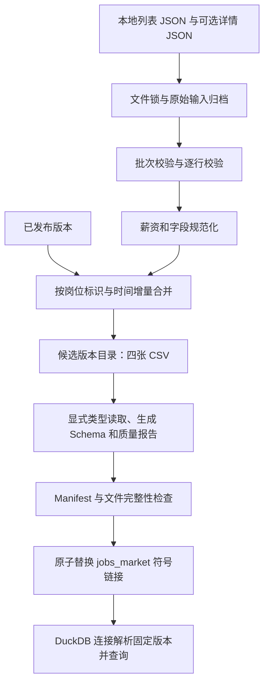

# 阶段一学习笔记：ETL 与岗位数据层

> 用途：理解项目设计、对照源码学习，并在求职面试前复习。本文以阶段一当前代码为准，区分“已经实现”“实现边界”和“后续演进”。代码片段标为“源码摘录”的来自仓库；标为“流程示意”的用于解释，不能替代实际实现。
>
> 阶段一交付时的记录：Python 全量测试 205 项通过，其中阶段一 43 项；前端生产构建通过。真实本地样本为 45 条岗位、45 条详情。这是当前样本和交付时的验证结果，不代表未知数据上的普遍准确率或生产容量。

## 阅读导航

第一次学习建议顺序阅读第 1～10 节，再结合第 14 节练习；面试前优先复习第 11～13 节和第 15～17 节。

1. [阶段一的任务、作用与必要性](#1-阶段一的任务作用与必要性)
2. [整体架构与代码地图](#2-整体架构与代码地图)
3. [四张表与运行时契约](#3-四张表与运行时契约)
4. [输入校验与源字段映射](#4-输入校验与源字段映射)
5. [薪资解析的设计与关键代码](#5-薪资解析的设计与关键代码)
6. [标签、技能、地点与详情规范化](#6-标签技能地点与详情规范化)
7. [增量合并、时间与幂等](#7-增量合并时间与幂等)
8. [CSV、Schema 与数据画像](#8-csvschema-与数据画像)
9. [单写入器与原子发布](#9-单写入器与原子发布)
10. [DuckDB 接入与本地权限](#10-duckdb-接入与本地权限)
11. [数据质量报告与错误处理](#11-数据质量报告与错误处理)
12. [测试如何证明设计成立](#12-测试如何证明设计成立)
13. [实现边界与后续改进](#13-实现边界与后续改进)
14. [动手运行与复习练习](#14-动手运行与复习练习)
15. [模拟面试问答](#15-模拟面试问答)
16. [项目介绍与简历表达](#16-项目介绍与简历表达)
17. [面试前自检清单](#17-面试前自检清单)

## 1. 阶段一的任务、作用与必要性

### 1.1 在整个项目中的位置

OfferAgent 要完成“采集岗位 → 查询市场 → 分析技能缺口 → 提供求职建议”。阶段零验证任务契约、状态和 SSE 传输；阶段一负责让后续 Agent 拥有可查询、可追溯的数据；阶段二再实现完整的 QueryAgent、Schema 全量注入和 SQL 自修正；阶段三负责简历与 JD 的证据分析。

阶段一的输入是已经保存到本地的 scraper JSON，输出是带版本的规范数据集。当前阶段一通过同步 CLI 离线执行，不调用 LLM，不启动浏览器，不实现新的采集调度器，也不执行自动投递。

ETL 三个字母在本项目中的具体含义：

| 步骤 | 项目中的工作 | 不应误解为 |
|---|---|---|
| Extract，提取 | 读取列表/详情 JSON，提取已知字段并校验 | 本阶段重新登录 BOSS 采集 |
| Transform，转换 | 薪资数值化、标签拆分、技能规范化、增量合并、质量统计 | 把所有缺失信息交给 LLM 补齐 |
| Load，加载 | 生成版本化 CSV 与 Schema，供 DuckDB 注册视图查询 | 必须向 PostgreSQL 等数据库执行 INSERT |

### 1.2 为什么不能直接让 LLM 查询原始 JSON

原始数据包含 `40-70K·13薪`、`300-500元/天`、`薪资面议` 等不同表示，还可能有重复岗位、缺失详情、混合标签和无时区时间。如果直接送入 Prompt：

- 同一薪资在不同问题中可能被模型换算成不同结果，缺少稳定统计口径。
- 同一岗位重复出现会放大计数，某个城市或技能可能被错误高估。
- 没有版本标识时，无法区分“模型改进了”与“查询的数据发生了变化”。
- 模型可能把无法解释的字段合理化，而不是保留缺失或未知状态。
- 原始 JD 体积较大，无法用可验证的 SQL 聚合替代重复文本推理。

阶段一将可确定的计算前移到普通程序中。之后即使模型生成的 SQL 在语法上可执行，也仍需检查业务语义，但至少不会每次重新解释数据格式。

### 1.3 阶段一的任务和下游收益

| 任务 | 直接产物 | 解决的问题 | 后续受益模块 |
|---|---|---|---|
| 固定字段映射 | `SourceJob` → `Job` / `JobDetail` | 源命名与分析命名不一致 | 所有 Agent |
| 薪资解析 | 原文、数值、周期、换算规则、状态 | 单位混乱、错误填零 | QueryAgent |
| 字段规范化 | 城市、区县、经验、学历、技能 | 标签无法可靠分组 | QueryAgent / CareerAgent |
| 去重与增量合并 | 当前岗位与最近有效详情 | 重复计数、旧数据覆盖新数据 | 市场分析 |
| 批次与版本管理 | `crawl_runs`、manifest | 数据来源和处理版本不明确 | 新鲜度判断、评测 |
| 数据质量报告 | `_quality.json` | 解析失败或拒绝数据不可见 | 开发、调试、解释报告 |
| 自动 Schema | `_schema.json` | Prompt 字段说明与 CSV 漂移 | 后续 SchemaCatalog |
| 数据发布与只读查询 | 稳定快照、受限 DuckDB 执行 | 查询读到半成品或越权读文件 | API / 工具层 |

验收重点是：**数据可重复处理，失败可以解释，Schema 与 CSV 一致，查询能读取完整的数据版本。**“生成了几张 CSV”只是其中一个结果。

## 2. 整体架构与代码地图

### 2.1 处理链路



这是一条确定性的本地数据管道。当前还没有在 FastAPI 任务执行器中自动调度 `run_etl()`。

### 2.2 代码地图

| 文件 | 职责 | 建议优先阅读的对象 |
|---|---|---|
| [backend/etl.py](../../backend/etl.py) | 参数解析与 CLI 入口 | `main()` |
| [models.py](../../backend/app/etl/models.py) | 源数据、规范行、质量报告和版本契约 | `SourceBatch`、`SourceJob`、`Job`、`QualityReport` |
| [salary.py](../../backend/app/etl/salary.py) | 薪资解析 | `Salary`、`parse_salary()` |
| [normalize.py](../../backend/app/etl/normalize.py) | 字段转换、标签证据、岗位合并 | `make_job()`、`merge_job()`、`extract_tags()` |
| [pipeline.py](../../backend/app/etl/pipeline.py) | 归档、幂等、合并、发布 | `run_etl()`、`_run_locked()`、`_build()` |
| [schema.py](../../backend/app/etl/schema.py) | 契约到 Schema、实际画像、加载验证 | `declared_schema()`、`generate_schema()` |
| [database.py](../../backend/app/database.py) | 将生成的表与关系注册到应用 | `_load_generated_schema()`、`DATABASE_LABELS` |
| [duckdb_engine.py](../../backend/app/querying/duckdb_engine.py) | CSV 视图、SQL 校验、执行 | `connect()`、`execute()` |
| [access_control.py](../../backend/app/security/access_control.py) | 本地用户与旧示例角色权限 | `AccessController.resolve()` |
| [test_stage1.py](../../backend/tests/test_stage1.py) | 阶段一规则与集成测试 | 薪资参数化测试、发布与增量测试 |

### 2.3 对外入口及参数

```python
run_etl(
    jobs_path: Path,
    details_path: Path | None,
    database_root: Path,
    raw_root: Path,
) -> QualityReport
```

| 参数 | 作用 | 约束与使用方式 |
|---|---|---|
| `jobs_path` | 列表 JSON 文件 | 必须提供，批次包含 `jobs` 和 `scraped_at` |
| `details_path` | 独立详情 JSON | 可为 `None`；未提供时使用列表 JSON 中的 `details` |
| `database_root` | 分析数据根目录 | 函数在其下管理 `jobs_market`、版本目录和写锁 |
| `raw_root` | 原始输入归档根目录 | 按 `run_id` 保存原始文件和该批次报告 |
| 返回值 | `QualityReport` | 此批次对应的质量报告；重放历史批次时不一定代表当前最新版本 |

CLI 的 `--database-root` 默认是项目 `data/databases`，`--raw-root` 默认是 `data/local/etl`。输出位置由项目文件位置决定，不要求工作目录恰好等于项目根，但命令中的相对输入路径仍按当前工作目录解释。

函数分层如下：

```text
main                         读取命令行参数，输出 JSON 报告
  └─ run_etl                 创建目录并持有文件锁
       └─ _run_locked        读原始字节、计算标识、归档、包装预期错误
            └─ _build        校验、加载旧数据、规范化合并、生成并发布快照
```

## 3. 四张表与运行时契约

### 3.1 先理解每张表“一行代表什么”

数据建模必须先确定粒度，否则后续 JOIN 和统计容易重复计数。

| 表 | 一行代表什么 | 当前保留方式 | 关键字段 |
|---|---|---|---|
| `jobs` | 一个岗位的当前合并快照 | 同 `job_id` 只留一行 | 薪资、地区、时间、版本 |
| `job_details` | 一个岗位最近保留的详情 | 同 `job_id` 最多一行 | `jd_text`、`jd_hash`、`captured_at` |
| `job_skills` | 一条带来源、证据和批次的标签记录 | 可跨来源/批次保留多条 | 标准技能、原文证据、版本、`run_id` |
| `crawl_runs` | 一个被成功接纳并发布的离线导入批次 | 追加历史批次 | 输入哈希、源状态、ETL 版本、数据集版本 |

`jobs` 不等于“当前仍在招聘的岗位全集”：没有出现在新批次中的旧岗位仍然保留，当前未实现下架识别。

`job_skills` 也不等于“每岗位每技能一行”：同一岗位的 Python 可能分别来自列表标签和详情标签，还可能出现于不同批次。

### 3.2 四张表的关系与正确统计

```text
jobs.job_id ── job_details.job_id
     │
     └──────── job_skills.job_id
                    │
                    └── job_skills.run_id ── crawl_runs.run_id
```

如果统计“提到 Python 的岗位数”，可以使用：

```sql
SELECT COUNT(DISTINCT job_id) AS python_jobs
FROM job_skills
WHERE skill_canonical = 'Python';
```

直接 `COUNT(*)` 得到的是证据记录数，可能把同一岗位重复计算。即便使用 `COUNT(DISTINCT job_id)`，上述查询仍表示**所有保留批次中曾经出现该证据的岗位数**；若要“最新要求”，还需明确定义每个岗位采用哪个批次、哪个来源的证据。当前尚未提供专门的最新技能视图。

Schema 中的 `primary_key` 和 `relations` 是元数据，不是 CSV 文件上的数据库主键/外键约束。唯一性和关联关系依赖 ETL 的字典合并、去重与孤立详情处理等逻辑。

### 3.3 为什么用 Pydantic

Pydantic 提供运行时校验，使原始 JSON、CSV 恢复对象和跨模块输出拥有明确结构。它与类型注解的区别是：类型注解主要帮助静态检查和阅读，`model_validate()` 会在运行时拒绝不合契约的数据。

源码摘录：

```python
class Record(BaseModel):
    model_config = ConfigDict(frozen=True, extra="forbid", allow_inf_nan=False)
```

这里的 `frozen=True` 约束模型属性重新赋值，但**不是递归深度不可变**：模型中的 list/dict 元素仍可能被修改。当前合并函数通过 `model_dump()` 构造新数据，再 `model_validate()` 生成新模型，避免原地改写输入对象；不能仅凭 `frozen=True` 声称整个状态深度不可变。

`SourceJob` 与规范模型采用不同策略：

- 源行使用 `extra="ignore"`，兼容 scraper 的额外 CDP 字段；这些字段仍留在完整原始 JSON 中。
- 源行启用 `strict=True`，例如数字类型的 `salary` 不会被偷偷当作合法薪资字符串。
- `SourceBatch` 没有全局启用 strict；不能说所有模型均严格禁止类型转换。
- `Record` 与 `Salary` 使用 `extra="forbid"`，限制规范输出的字段漂移，并拒绝 NaN/Infinity。
- `Job` 继承 `Salary`，因此同时包含薪资规范结果与岗位业务字段。

## 4. 输入校验与源字段映射

### 4.1 为什么分批次校验和逐行校验

`SourceBatch.jobs` 的类型是 `list[JsonValue]`，而不是直接 `list[SourceJob]`。这是为了允许逐行检查：一条坏岗位不必导致整个文件中的好岗位被放弃。

执行顺序为：

1. `SourceBatch.model_validate_json(jobs_bytes)` 验证 JSON、顶层字段、采集时间、状态和页数关系。
2. `read_valid_rows()` 对每条岗位或详情单独构造 `SourceJob`。
3. 不合格行产生 `QualityIssue` 和结构化 warning，合格行继续参与处理。
4. 如果没有任何有效岗位，则整个批次失败，不发布空快照。

源码摘录：

```python
def read_valid_rows(values: list[object], source: str, issues: list[QualityIssue]) -> list[SourceJob]:
    rows = []
    for index, value in enumerate(values, 1):
        try:
            rows.append(SourceJob.model_validate(value))
        except ValidationError as exc:
            issues.append(QualityIssue(source=source, row=index, code="invalid_record",
                                       fields=[".".join(map(str, error["loc"])) for error in exc.errors(include_input=False)]))
            logger.warning("etl_record_rejected", extra={"source_kind": source, "row_index": index, "error_count": exc.error_count()})
    return rows
```

参数说明：

| 参数 | 含义 |
|---|---|
| `values` | 尚未验证的源行集合 |
| `source` | 问题来源标签，当前为 `jobs` 或 `details` |
| `issues` | 调用方传入的问题收集列表，函数会向其追加问题 |
| 返回值 | 仅包含验证通过的 `SourceJob` 列表 |

`exc.errors(include_input=False)` 获取错误字段位置而不复制完整输入，日志只记录来源、行号和错误数量。该函数会修改 `issues`，属于当前实现中显式的副作用，不能描述为纯函数。

还要区分“记录结构合法”和“信息完整”：除标识校验外，许多源字段允许空字符串。某条岗位缺标题、地点或薪资，不一定会在这一层被拒绝；后续会产生未知值或薪资失败状态。

### 4.2 源字段映射

| 源字段 | 规范字段或处理 |
|---|---|
| `salary` | `salary_raw` 与整组薪资解析结果 |
| `jd` | 去除首尾空白后存为 `jd_text`，计算 `jd_hash` |
| 顶层 `scraped_at` | `crawl_runs.started_at` 和新岗位的观察时间 |
| 详情 `captured_at` | 详情/技能抽取时间；缺失时使用批次时间 |
| `job_id` | 优先继承；缺失则由 `job_link` 或 `link` 计算 |
| `location` | 保留 `location_raw`，拆出 `city`、`district` |
| `tags` / `tags_list` | 首选非空 `tags`，否则使用 `tags_list`；再拆分、去重 |
| `skills` | 生成 `jobs.skills`，并参与列表技能证据抽取 |
| `skill_tags` | 详情标签与 `detail_tags` 技能证据 |
| `welfare` | 拆成列表，不再直接用拼接文本统计 |
| 详情 `company` | 满足时间条件时回填岗位公司 |
| `requested_pages` / `completed_pages` | 如实保存；缺失为 NULL，不由岗位数反推 |
| 未知扩展字段 | 不进入规范分析表，保留在原始 JSON |

独立 `--details` 输入支持数组或包含 `details` / `jobs` 的对象；存在有效的独立详情文件时，它替代内嵌 `details`，不是自动把两份详情拼起来。缺少有效结构会导致校验失败。

### 4.3 标识与时间的处理

源码摘录：

```python
def identity(source: SourceJob) -> str:
    link = (source.job_link or source.link).strip()
    expected = hashlib.md5(link.encode()).hexdigest()[:16] if link else ""
    return source.job_id.strip() or expected
```

- 有 `job_id` 就继承，不要求它一定等于链接的 MD5。
- 没有 ID 时，通过链接生成截断的 MD5，保持与原 scraper 的标识习惯兼容。
- 没有 ID 也没有链接时，`SourceJob` 校验失败；不使用岗位标题作为可靠唯一键。
- 合并时如果同一个 ID 对应两个不同的非空链接，明确失败，避免把不同岗位混在一起。

MD5 在这里是兼容性标识算法，不用于密码学安全，也不能保证绝对无碰撞。代码尚未规范化 URL 查询参数、重定向或追踪参数，因此同一岗位不同链接可能得到不同 ID。

源码摘录：

```python
def normalize_time(value: datetime) -> datetime:
    # 源 scraper 使用 datetime.now().isoformat()，历史无时区时间按中国标准时间处理。
    if value.tzinfo is None:
        value = value.replace(tzinfo=ZoneInfo("Asia/Shanghai"))
    return value.astimezone(timezone.utc)
```

`replace(tzinfo=...)` 是给缺时区的历史时间指定解释规则；`astimezone()` 才是时区转换。`2026-09-01T12:00:00+08:00` 会规范成 UTC 的 `04:00:00`。无时区输入按 Asia/Shanghai 解释是项目约定，不能推广为任何数据源的默认事实。

## 5. 薪资解析的设计与关键代码

### 5.1 输出不是一个数字

`parse_salary(raw: str) -> Salary` 接收完整薪资字符串，不访问文件或网络，也不依赖当前时间。相同输入得到相同解析结果，适合参数化测试。

| 字段组 | 作用 |
|---|---|
| `salary_raw` | 原始字符串，便于审计与重新解析 |
| `salary_min_k` / `salary_max_k` | 统一为 K/月的区间 |
| `salary_months` | 薪月数，未指定时默认 12 |
| `salary_annual_min_k` / `salary_annual_max_k` | 由月薪口径与薪月数得到的年化范围 |
| `salary_unit` / `salary_period` | 保留原始单位和周期，避免丢失换算依据 |
| `salary_parse_status` | 区分成功、面议、不支持和非法 |
| `salary_conversion_rule` | 标注 `monthly_native`、`daily_x_22`、`annual_div_12` |
| `is_negotiable` | 明确表示面议 |

将面议设为 0 会压低平均薪资；删除解析失败的岗位又会使市场样本偏向“容易解析”的记录。因此当前保留岗位与原文，把不可计算的数值置为 NULL。

### 5.2 关键实现

源码摘录：

```python
def parse_salary(raw: str) -> Salary:
    """月薪单位为 K；日薪按 22 天估算，年薪按 12 月折算，未知口径不猜测。"""
    text = re.sub(r"\s+", "", unicodedata.normalize("NFKC", raw))
    text = text.replace("—", "-").replace("–", "-").replace("~", "-").replace("～", "-")
    if text in {"面议", "薪资面议", "工资面议"}:
        return Salary(salary_raw=raw, is_negotiable=True, salary_parse_status="negotiable")
    match = _PATTERN.fullmatch(text)
    if not match:
        return Salary(salary_raw=raw, salary_parse_status="unsupported" if text else "invalid")
    low = Decimal(match["low"])
    high = Decimal(match["high"] or match["low"])
    unit = (match["unit2"] or match["unit1"] or "").upper()
    period = match["period"] or ("年" if match["annual"] else "月")
    months = int(match["months"] or 12)
    if (low <= 0 or high < low or not 1 <= months <= 36
        or (match["unit1"] and match["unit2"] and match["unit1"].upper() != unit)
        or (match["annual"] and period != "年")
        or (period != "月" and match["months"])):
        return Salary(salary_raw=raw, salary_parse_status="invalid")
    periods = {"月": "month", "天": "day", "日": "day", "年": "year", "小时": "hour", "时": "hour"}
    if not unit or period in {"小时", "时"} or (unit in {"万", "元"} and not match["period"] and not match["annual"]):
        return Salary(salary_raw=raw, salary_unit=unit or None, salary_period=periods[period], salary_parse_status="unsupported")
    factor = {"K": Decimal(1), "万": Decimal(10), "元": Decimal("0.001")}[unit]
    rule = "monthly_native"
    if period in {"天", "日"}:
        factor *= 22
        rule = "daily_x_22"
    elif period == "年":
        factor /= 12
        rule = "annual_div_12"
    return Salary(
        salary_raw=raw, salary_min_k=float(low * factor), salary_max_k=float(high * factor),
        salary_months=months, salary_annual_min_k=float(low * factor * months),
        salary_annual_max_k=float(high * factor * months), salary_unit=unit,
        salary_period=periods[period], salary_parse_status="parsed", salary_conversion_rule=rule,
    )
```

按执行顺序理解：

1. `unicodedata.normalize("NFKC", raw)` 统一全角数字等兼容字符；清理空白和常见区间连接符。
2. 先识别面议，直接返回 `negotiable`。
3. 正则使用 `fullmatch()`，要求整个字符串符合语法；不从 `20K + 提成` 中随意截取 `20K`。
4. 使用正则命名组读取金额、单位、周期、薪月。
5. 检查金额、区间、单位冲突和薪月合法性。
6. 对可解释周期执行单位换算；未知口径保留为 `unsupported`。
7. 使用 `Decimal` 完成中间十进制计算，最后输出 float，CSV 查询类型为 DOUBLE。

因此，**内部使用 Decimal 不等于全链路精确十进制存储**。当前用于市场统计，测试用近似比较；若用于工资结算，需要独立设计金额精度、舍入和存储类型。

### 5.3 薪资公式与示例

| 原始格式 | 规范月薪 K | 薪月数 | 年薪 K | 规则 |
|---|---:|---:|---:|---|
| `40-70K·13薪` | 40～70 | 13 | 520～910 | 原生月薪 |
| `25-35K` | 25～35 | 12 | 300～420 | 原生月薪 |
| `1-2万/月` | 10～20 | 12 | 120～240 | 万转千元 |
| `8000-12000元/月` | 8～12 | 12 | 96～144 | 元转千元 |
| `300-500元/天` | 6.6～11 | 12 | 79.2～132 | 日薪 × 22 ÷ 1000 |
| `年薪 30-50 万` | 25～41.666… | 12 | 300～500 | 万 × 10 ÷ 12 |
| `200-260K·24薪` | 200～260 | 24 | 4800～6240 | 保留源薪月信息 |

年薪 30 万 = 300 K/年，除以 12 得到 25 K/月。阶段一修正了原设计文档中错误的十倍换算。

日薪年化只是“每月 22 天、持续 12 个月”的估算，不是实习合同承诺。`salary_months` 的 1～36 是当前程序校验范围，不是劳动薪酬的普遍规则。超大金额未设置业务异常阈值，解析成功不代表数据真实可信。

### 5.4 状态边界

| 状态 | 示例 | 处理与解释 |
|---|---|---|
| `parsed` | `25-35K` | 生成数值与换算规则 |
| `negotiable` | `薪资面议` | 面议标记为真，数值为 NULL |
| `unsupported` | `底薪+提成`、`50元/小时`、`30-50万` | 语义或周期不足，保留原文，不强行折算 |
| `invalid` | 空字符串、`30-20K`、`0-10K`、`20K·0薪` | 命中当前非法值规则，保留原文 |

这些是程序分类，不是通用自然语言薪资分类器。例如某种负数写法可能根本不能匹配正则，被归为 unsupported，而不是 invalid。测试和解释应以明确覆盖的格式为准。

### 5.5 正确查询薪资

```sql
SELECT
    city,
    salary_period,
    salary_conversion_rule,
    COUNT(job_id) AS sample_count,
    AVG((salary_min_k + salary_max_k) / 2) AS mean_range_midpoint_k
FROM jobs
WHERE salary_parse_status = 'parsed'
  AND salary_source = 'api'
GROUP BY city, salary_period, salary_conversion_rule;
```

该查询计算的是“岗位标示薪资区间中点的平均值”，不是实际员工平均工资。`AVG` 排除 NULL，因此必须同时说明样本数与缺失情况；按周期和换算规则分组，避免把日薪估算值混成原生月薪。

## 6. 标签、技能、地点与详情规范化

### 6.1 拆分与去重

源码摘录：

```python
def split_values(value: str | list[str]) -> list[str]:
    values = [value] if isinstance(value, str) else value
    return list(dict.fromkeys(part.strip() for item in values for part in re.split(r"[|｜]", item) if part.strip()))
```

`split_values(value)` 同时接受单个字符串和字符串数组；每个数组项也会进一步按半角/全角管道符拆分。`strip()` 去首尾空白，`dict.fromkeys()` 保留首次出现顺序并去重。

示例：

```text
输入："五险一金 | 带薪年假｜五险一金"
输出：["五险一金", "带薪年假"]
```

它不会把所有标点都当分隔符，避免错误拆解技能名，也不负责识别任意自由文本中的技能。

### 6.2 技能别名与证据

源码摘录：

```python
def canonical_skill(text: str) -> str:
    key = re.sub(r"\s+", "", unicodedata.normalize("NFKC", text)).casefold()
    return ALIASES.get(key, text.strip())
```

`casefold()`、NFKC 和去空白用于别名表查找；命中时返回标准名，否则保留去首尾空白的原标签。例如 `Python3` → `Python`，`k8s` → `Kubernetes`，`检索增强生成` → `RAG`。

函数契约：

```python
extract_tags(
    source: SourceJob,
    timestamp: datetime,
    run_id: str,
    *,
    detail: bool,
) -> list[JobSkill]
```

| 参数 | 作用 |
|---|---|
| `source` | 已校验的源行 |
| `timestamp` | 缺少行级时间时使用的批次时间 |
| `run_id` | 让每条技能证据可追溯到导入批次 |
| `detail=False` | 从 `skills` 和混合 `tags` / `tags_list` 取列表证据 |
| `detail=True` | 从 `skill_tags` 取详情证据 |
| `*` | 要求 `detail` 通过关键字传入，调用含义更明确 |

这里的布尔参数只用于选择两种标签来源，是现有实现；它没有包含 JD 模型抽取等不同工作流。如果来源扩展为 regex/LLM，应重新考虑独立函数或明确的抽取器接口，不应持续叠加开关。

混合 `tags` 可能同时包含“本科”“经验不限”“Python”，因此先排除学历/经验，再只从该混合字段接受已知技能。明确的 `skills`、`skill_tags` 允许保留未知标签，类别为 `other`。

技能证据保留：标准名、展示名、来源、原始标签、抽取器版本、抽取时间、批次。`confidence=1.0` 只表示确定地读取到了标签，并不是“模型判断该岗位百分之百需要此技能”。

### 6.3 经验、学历和地点

- `degree_tag()` 识别预定义学历集合，并去掉部分“及以上/以上”后缀。
- `experience_tag()` 映射“应届生”“在校生”等别名，也识别 `1-3年` 形式。
- `make_job()` 从标签中选第一个识别到的学历/经验，找不到则为“未知”；“未知”不等于“不限”。
- `location` 按 `·` / `•` 拆分，第一段为城市、第二段为区县，完整原文另存。

这些是有限规则，不是行政区划识别器或完整枚举标准化器。多个冲突学历、非标准经验区间、英文城市等尚未被系统性解决。当前 `degree_tag()` 简单去后缀还存在需要补测的边缘情况，例如集合中的“初中及以下”；面试时不应声称所有学历写法已完美覆盖。

### 6.4 详情完整性与内容哈希

`make_detail(source, timestamp)` 使用 `source.captured_at`，否则使用批次时间；将去首尾空白的 `jd` 转为 `jd_text`，并计算 SHA-256。

`detail_status="complete"` 当前仅表示 `jd_text` 非空，**并没有验证网页内容是否截断**。`jd_hash` 用于标识保留的文本是否变化，也不证明原网页内容完整或真实。

目前列表源中的 `jd` 不会自动当作详情导入：管道仅对独立/内嵌详情集合调用 `make_detail()`。应按实际输入结构提供详情。

## 7. 增量合并、时间与幂等

### 7.1 三种标识不要混淆

| 标识 | 表达的对象 | 当前生成方式 |
|---|---|---|
| `job_id` | 岗位身份 | 继承源 ID，或链接的截断 MD5 |
| `run_id` | 一个内容确定的离线导入批次 | 原始列表/详情字节哈希与 ETL 版本组合哈希 |
| `dataset_version` | 当前累计数据处理到哪一步 | 上一数据集版本与本次 `run_id` 组合哈希 |

`run_id` 当前由 ETL 生成，而不是接收一个真实调度系统分配的采集任务 ID。`crawl_runs` 这个表名表达设计方向，不能据此声称真实采集任务状态机已经接入。

源码摘录（来自 `_run_locked()`）：

```python
jobs_bytes = jobs_path.read_bytes()
details_bytes = details_path.read_bytes() if details_path else b""
source_hash = digest(jobs_bytes + b"\0" + details_bytes)
run_id = "run_" + digest((source_hash + ETL_VERSION).encode())[:24]
```

中间的 `b"\0"` 用于分隔两个输入字节串。内容哈希还意味着：**相同语义 JSON 改变空白、键顺序或记录顺序，都会产生新的批次 ID。**当前实现是字节级幂等，不是规范 JSON 语义级幂等。

### 7.2 幂等判断

源码摘录（来自 `_build()`）：

```python
if manifest and run_id in manifest.run_ids:
    return QualityReport.model_validate_json((archive / "quality.json").read_text(encoding="utf-8"))
version = "ds_" + digest(((manifest.dataset_version if manifest else "") + run_id).encode())[:24]
```

流程是先校验旧版本完整性，再查看 manifest 中是否已有本次 `run_id`。已有则读取原始归档中的 `quality.json` 返回，不新增批次，不重新发布，也不把当前数据集回退到那个历史版本。

调用方应注意：重放旧批次拿到的是旧批次报告，其中的 `dataset_version` 可能早于当前版本。若要“当前版本”，应读取当前 manifest，不能把返回报告总当最新状态。

同一分析库应长期配套使用同一 `raw_root`；如果换了归档根或删掉历史 `quality.json`，旧 manifest 能识别批次，但无法读取对应原报告，当前会失败而不是自动重建报告。

### 7.3 增量岗位合并

源码摘录：

```python
def merge_job(old: Job, new: Job) -> Job:
    newer, older = (new, old) if new.latest_scraped_at >= old.latest_scraped_at else (old, new)
    data = newer.model_dump()
    # 缺失新字段不能擦掉旧详情；已提供的新值（包括面议/未知薪资）必须保留。
    for name in ("title", "company", "city", "district", "location_raw", "company_scale", "company_stage",
                 "company_industry", "boss_active_status", "job_link", "keyword", "salary_source"):
        data[name] = data[name] or getattr(older, name)
    for name in ("tags", "skills", "welfare"):
        data[name] = data[name] or getattr(older, name)
    for name in ("degree", "experience"):
        if data[name] == "未知":
            data[name] = getattr(older, name)
    if not newer.salary_raw.strip():
        data.update({name: getattr(older, name) for name in type(parse_salary("")).model_fields})
    data.update(first_seen_at=min(old.first_seen_at, new.first_seen_at),
                last_seen_at=max(old.last_seen_at, new.last_seen_at), dataset_version=new.dataset_version)
    return Job.model_validate(data)
```

`old` 是当前已积累的岗位记录，`new` 是此次导入候选。函数先比较 `latest_scraped_at`，因此参数名 `new` 不表示采集时间一定更新。

关键规则：

| 场景 | 当前行为 |
|---|---|
| 新记录时间更新 | 以新记录为主体 |
| 导入的是更早批次 | 以旧记录为主体，仍可补缺失字段 |
| 时间相同 | 本次输入优先；同批次重复行因此受输入顺序影响 |
| 新主体的公司、链接等字符串为空 | 使用另一条记录的值补齐 |
| 新主体的列表为空 | 保留另一条的列表，不执行集合并集 |
| 学历/经验为“未知” | 尝试保留已有值 |
| 新薪资原文为空 | 整组保留旧薪资解析字段 |
| 新薪资明确为面议或未知格式 | 接受新原文及新解析状态，不用旧数值掩盖变化 |
| 任意合并 | 首次时间取最小值，最近出现取最大值，绑定本次输出版本 |

三个时间字段分别表示首次观察、最后观察，以及当前合并记录使用的最近采集时间。缺失字段会回填，因此同一岗位行可能综合多个时间的字段；它没有保存字段级来源时间，`latest_scraped_at` 不能说明每个字段都来自该时刻。

### 7.4 详情与技能如何合并

详情更新要求候选采集时间不早于旧详情，且新文本非空或旧文本本来为空。这里保留的是“最近有效详情”，所以它可能早于最近一次岗位观察时间。

技能证据按以下组合去重：

```text
job_id + skill_canonical + source + evidence_text + extractor_version + run_id
```

同一技能来自不同原标签、来源或批次时会保留多条。这样适合回溯，但不能直接当作最新岗位技能集合。

详情公司回填还会与岗位时间比较；当前没有独立的公司字段时间戳。因此“旧详情绝不会影响任何更新字段”比实现保证更强，不适合在面试中这样表述。

### 7.5 版本并不保证导入顺序无关

`dataset_version` 包含前一版本，因此先 A 后 B 与先 B 后 A 的版本 ID 通常不同。时间合并能避免一部分旧数据覆盖，但同时间冲突、缺失回填、关键词选择和技能历史顺序仍可能影响结果。

当前能承诺的是：明确输入字节、ETL 版本、初始数据集和导入顺序时，业务处理规则可追踪。不能承诺整个输出目录字节级完全复现，因为导入完成时间和临时目录后缀也会变化。

## 8. CSV、Schema 与数据画像

### 8.1 为什么使用 CSV + DuckDB

这是沿用现有 AskData 执行器的取舍：CSV 易检查、易导出，DuckDB 可在本地执行 SQL 聚合，无需启动数据库服务。它适合当前小规模、单机、批处理数据。

当前并没有把分析数据持久化为一个 `.duckdb` 文件：每次查询创建内存连接，并将 CSV 注册成视图。持久化的是 CSV 与元数据，DuckDB 负责查询。

代价包括 CSV 扫描和解析、缺少存储级事务/外键、大规模批量重写成本，以及应用自己维护数据版本。后续根据性能与工作负载，可选择 Parquet、持久化 DuckDB 或事务数据库，不需要现在同时引入它们。

### 8.2 CSV 为什么不能随意自动推断类型

假设全部岗位都是面议，`salary_min_k` 整列为空。自动推断可能无法得知这是数值列；空技能表也没有任何样本供推断。

本项目采用：

```text
Pydantic 行契约
   ├─ model_fields → CSV 的字段名和顺序
   └─ model_json_schema() → 数据类型与 Schema 列
                                    ↓
                            DuckDB 按指定类型读 CSV
```

当前映射：

| 模型类型 | DuckDB 类型 | 说明 |
|---|---|---|
| string / Literal 字符串 | VARCHAR | 枚举仍由 Pydantic 约束 |
| number | DOUBLE | 薪资与置信度 |
| integer | BIGINT | 薪月数、计数、页数 |
| boolean | BOOLEAN | 是否面议 |
| date-time | TIMESTAMP | 数据先统一 UTC，再按 UTC 约定解释 |
| array | VARCHAR | 内容是 JSON 数组文本，不是 DuckDB LIST |

`TIMESTAMP` 本身不携带时区；正确性依赖写入前统一 UTC。不能说数据库字段自身保留了原始时区。

### 8.3 写入与恢复

`write_rows(path, model, rows)` 用 `model.model_fields` 作为表头，`model_dump(mode="json")` 将 datetime 等转换成 JSON 友好值，list 再经 `json.dumps(..., ensure_ascii=False)` 写为一个 CSV 单元格。

Python 的 CSV writer 负责处理逗号、引号和换行的转义。不要手工用 `','.join()` 拼接完整 JD。

`read_rows(path, model)` 根据模型 JSON Schema 判断数组和可空字段：空值恢复为 None，数组文本经 `json.loads()` 恢复，再调用 `model_validate()`。CSV 没有原生类型，所以内部恢复允许受控的字符串到数字/时间转换，这与外部源行严格校验的目标不同。

### 8.4 Schema 生成器

函数及参数：

| 函数 | 输入 | 输出/副作用 |
|---|---|---|
| `declared_schema(version="unpublished")` | 数据集版本 | 按当前四个行模型生成 `MarketSchema`，无需数据文件 |
| `csv_expression(path, columns)` | CSV 路径、已声明列 | 返回 DuckDB 显式类型读取表达式 |
| `generate_schema(folder, version)` | 完整候选 CSV 目录、版本 | 读取实际 CSV 计算画像，写 `_schema.json`，返回 Schema |
| `load_market_schema(folder)` | 某个数据目录 | 读取并校验 Schema、表结构与 CSV 表头 |

源码摘录：

```python
def csv_expression(path: Path, columns: list[ColumnSchema]) -> str:
    file = path.resolve().as_posix().replace("'", "''")
    types = ", ".join(f"'{column.name}': '{column.source_type}'" for column in columns)
    return f"read_csv('{file}', header=true, auto_detect=false, columns={{{types}}}, nullstr='', strict_mode=true)"
```

- `auto_detect=false`：不通过当前样本重新猜测类型。
- `columns={...}`：为每个字段固定 DuckDB 类型。
- `nullstr=''`：CSV 空单元格按 NULL 读取。
- `strict_mode=true`：不静默跳过结构不合法的 CSV。
- 路径中的单引号被转义；列来自模型和已验证 Schema，而非自由文本用户输入。

生成 Schema 时会核对 CSV 表头的字段和顺序，再创建临时视图扫描真实文件。字段画像包括行数、NULL 数、非 NULL 去重数和最多三条字符串化样例。字段样例按单值最多 120 字符截断。

`jd_text`、`evidence_text`、`job_link`、`company`、`title` 不复制样例到 Schema。但这不是通用脱敏系统，也不能证明所有剩余标签绝对无敏感信息。

### 8.5 结构一致性与业务语义是两件事

阶段一验证了结构和类型可读取，不代表已经校验所有业务规则。例如 Schema 的 `aggregation` 当前由类型较粗略地生成；某个 DOUBLE 被标注可平均，并不意味着对它做 AVG 就符合用户问题。

另外，声明 Schema 的主键和关系仍只是元数据；`load_market_schema()` 主要比较表名、列名、类型和 CSV 表头，并未把所有描述、主键和关系重新验证为业务真理。阶段二需要补充 Prompt 语义与评测约束。

## 9. 单写入器与原子发布

### 9.1 为什么不能原地覆盖四个 CSV

如果先改 `jobs.csv`，再改 `job_details.csv`，最后写 `_schema.json`，查询可能读到来自不同批次的文件。即使每个文件单独写入成功，也没有保证整组数据一致。

当前目录形态：

```text
data/databases/
├── .jobs_market.lock
├── .jobs_market_versions/
│   ├── ds_<版本A>_<随机后缀>/
│   │   ├── jobs.csv
│   │   ├── job_details.csv
│   │   ├── job_skills.csv
│   │   ├── crawl_runs.csv
│   │   ├── _schema.json
│   │   ├── _quality.json
│   │   └── _manifest.json
│   └── ds_<版本B>_<随机后缀>/
└── jobs_market -> .jobs_market_versions/ds_<版本B>_<随机后缀>/
```

版本目录由程序按“不再修改已发布文件”的约定使用，而不是通过文件权限变成物理不可变文件。

### 9.2 文件锁控制并发写入

源码摘录：

```python
def run_etl(jobs_path: Path, details_path: Path | None, database_root: Path, raw_root: Path) -> QualityReport:
    """离线单写入器 ETL。先完整生成和校验快照，再原子切换 jobs_market 链接。"""
    database_root.mkdir(parents=True, exist_ok=True)
    raw_root.mkdir(parents=True, exist_ok=True)
    with (database_root / ".jobs_market.lock").open("a") as lock:
        try:
            fcntl.flock(lock, fcntl.LOCK_EX | fcntl.LOCK_NB)
        except BlockingIOError as exc:
            raise EtlError("另一个 ETL 正在发布岗位库；请等待其结束后重试") from exc
        # 使用打开的文件描述符持有 OS 锁，进程崩溃也会自动释放。
        return _run_locked(jobs_path, details_path, database_root, raw_root)
```

- `LOCK_EX`：排他锁，同一分析根目录只允许一个合作式 ETL 写入器。
- `LOCK_NB`：拿不到锁立即抛错，不让 CLI 无限等待。
- `with ... open()`：文件描述符在调用期间保持打开；离开上下文或进程退出后释放锁。
- 该锁依赖 `fcntl`，面向当前 macOS/Linux 环境，不是跨平台分布式锁。

锁是合作式机制，不会阻止用户用编辑器直接修改 CSV，也不为不同 `database_root` 配套共用同一 `raw_root` 的写入提供统一锁。

### 9.3 发布顺序与切换点

候选目录写完四张 CSV 后，生成 Schema 和质量报告，再生成 manifest。manifest 包含数据集版本、ETL 版本、历史 `run_ids` 和六个产物的内容哈希：四张 CSV、Schema、质量报告；manifest 本身不在自己的哈希清单中。

`_verify_snapshot(folder)` 检查文件名边界、清单完整性、文件哈希，并加载 Schema 验证。候选版本通过后才进入切换。

源码摘录（来自 `_build()`）：

```python
_verify_snapshot(folder)
(archive / "quality.json").write_text(report.model_dump_json(indent=2), encoding="utf-8")
pending = database_root / f".jobs_market_{folder.name}.link"
pending.symlink_to(folder.relative_to(database_root), target_is_directory=True)
os.replace(pending, target)
```

临时符号链接与目标都放在相同根目录中，`os.replace()` 原子替换的是**一个链接目录项**。它让读者看到旧入口或新入口，避免暴露“只写完两张表”的目录。

每个 DuckDB 连接先解析当前链接到具体版本路径，再为该目录里的 CSV 建视图。因此连接存续期间继续读旧版本，新连接可读新版本。此性质依赖旧版本文件未被人为修改或删除。

### 9.4 崩溃窗口如何分析

| 出错时点 | 当前可见数据 | 遗留与恢复方式 |
|---|---|---|
| 输入读取/归档之前 | 原版本 | 可能没有归档或 failure 文件，检查原始文件权限 |
| 归档后、校验失败 | 原版本 | 预期异常通常写 `failure.json`，修正输入后重试 |
| 候选目录生成中 | 原版本 | 可能留下未发布目录，不会成为查询入口 |
| 原报告写入后、切换前 | 原版本 | 归档可能已有候选报告，但没有新发布版本 |
| 链接切换后 | 新版本 | 即使调用方没收到成功输出，重试可根据 run_id 检测重复 |

这是“完整生成后原子切换”的发布协议，不是包含所有文件、归档、日志的 ACID 事务。当前未对文件和父目录执行完整 fsync 协议，不承诺突然断电后的持久性；未做自动历史清理和恢复编排。

哈希校验也只用于完整性检查，不是防篡改签名：如果攻击者能够同时修改数据和 manifest，普通内容哈希并不能鉴别其来源。

## 10. DuckDB 接入与本地权限

### 10.1 通用 Schema loader 的作用

`database.py` 扫描根目录与 backend 中的数据库 Schema，岗位数据从项目级 `data/databases/jobs_market` 加载，原有示例数据仍保留在 backend 数据目录。

没有岗位数据时仍注册 `declared_schema()` 的契约，使应用可以展示表结构；真正查询不存在的数据目录会失败，不会把“没有导入”伪装成零条结果。

Schema 注册到进程内的 `SCHEMA` / `RELATIONS`。CSV 新连接会读取最新快照，但已启动服务中的画像不会自动热刷新，所以 ETL 后需要重启后端。当前不是全链路按版本锁定的 Agent 查询事务。

### 10.2 查询函数及参数

```python
DuckDbEngine(database_root: Path | None = None)

execute(
    database: str,
    sql: str,
    access_scope: AccessScope | None = None,
) -> SqlExecution
```

| 参数 | 含义 |
|---|---|
| 构造器 `database_root` | 可指定独立测试/演示数据根；默认使用项目数据根并兼容旧示例目录 |
| `database` | 数据库标识，例如 `jobs_market`，不是任意路径 |
| `sql` | 待验证的 SQL |
| `access_scope` | 用户允许访问的数据库和表；应用工具调用应传入 |
| 返回值 | `success`、列、结果行或错误信息；预期 SQL 错误不都以 Python 异常抛出 |

`connect(database)` 是供内部使用的连接上下文管理器，会注册视图并关闭连接。直接使用它执行 SQL 不会自动经过 `_validate_sql()`；接收用户/模型 SQL 的入口应使用 `execute()`。

`execute()` 最多返回 200 行，内部读取 201 行。**结果行数截断不是执行超时，也不是扫描成本上限。**昂贵 JOIN/聚合仍可能运行很久，当前未实现查询取消或统一资源预算。

### 10.3 防护分层

1. 使用 SQLGlot 按 DuckDB 方言解析，仅接收单条查询。
2. 拒绝写入/管理操作；查询投影不能用 `SELECT *` 或 `table.*`，但聚合 `COUNT(*)` 与星号投影不是一回事。
3. 检查数据库和表访问范围，限定在 Schema 白名单内。
4. 拒绝外部表函数和带数据库/目录限定的表名；例如当前连 `main.jobs` 也拒绝，调用方直接写 `jobs`。
5. 注册受信任的 CSV 视图后，设置允许读取的文件列表，再关闭其他外部访问。

源码摘录（来自 `connect()`）：

```python
connection.execute("SET allowed_paths = ?", [[str(p.resolve()) for p in csv_files]])
connection.execute("SET enable_external_access = false")
```

只关闭 `enable_external_access` 而不允许当前 CSV 路径，会连合法 CSV 视图都无法查询。这两项配置必须配套理解。

防护重点是应用层只读查询和外部文件访问边界，不能宣传为任意 SQL 的完整安全沙箱。资源耗尽、复杂方言边缘和上游库漏洞仍需要独立治理。

### 10.4 单一本地用户的准确含义

API 的 `require_user()` 在没有 Authorization 头时返回 `local_user`；该用户只拥有 `jobs_market` 权限。若显式带了无效 Bearer token，仍返回 401，不降级成匿名用户。

旧 AskData 的 admin、sales、mock 演示账号仍保留；`AccessController.DEFAULT_USER` 仍是旧内部默认用户 `demo_analyst`。所以在内部代码示例中应显式写 `resolve("local_user")`，不能声称所有不传用户的代码路径都已经统一为本地用户。

本地模式简化了学习项目的访问方式，但不是生产认证。旧示例账号保留以及阶段零假任务路由的已有边界，都不能被包装为已实现严格的多租户隔离。

## 11. 数据质量报告与错误处理

### 11.1 批次指标与快照指标

| 指标 | 统计范围 | 解释 |
|---|---|---|
| `input_jobs` | 本批次 | 原列表记录数 |
| `accepted_jobs` / `rejected_jobs` | 本批次 | 校验通过/拒绝的源行数 |
| `duplicate_jobs` | 本批次 | 本批次有效行中重复 job_id 的次数，不是与历史库重复次数 |
| `input_details` / `rejected_details` | 本批次 | 原详情数量/结构不合格数量 |
| `orphan_details` | 本批次 | 校验通过但无法关联到累计岗位库的详情数 |
| `total_jobs` | 当前快照 | 增量合并后的岗位总数 |
| `salary_status_counts` | 当前快照 | 每种解析状态对应的岗位数 |
| `salary_failure_count` | 当前快照 | unsupported + invalid，不包含面议 |
| `salary_untrusted_count` | 当前快照 | 薪资来源不属于 `api` / `fixture` 的岗位数 |
| `missing_detail_count` | 当前快照 | 没有详情或保留 JD 为空的岗位数 |
| `issues` | 本批次处理 | 错误来源、序号、问题码和字段 |

可用于检查的关系：

```text
accepted_jobs + rejected_jobs = input_jobs
sum(salary_status_counts.values()) = total_jobs
salary_failure_count = unsupported_count + invalid_count
```

没有出现的状态可能不在计数字典中，调用方应按 0 处理。`accepted_jobs` 是有效源行数，重复记录也包含在其中，不能当唯一岗位数。

`salary_untrusted_count` 只是质量标记，当前不会自动剔除这些岗位的薪资；后续查询需要按来源过滤或显式披露。

### 11.2 源采集成功与离线导入成功不同

历史 scraper JSON 不一定保存完整任务状态、页数和版本。当前不由“有 45 条数据”推断“采集成功完成了所有页”。

- `source_status="unknown"` 表示无法确认源采集状态，仍允许离线导入。
- `crawl_runs.status="succeeded"` 表示本批次 ETL 被成功接纳和发布。
- `started_at` 使用源 `scraped_at`，不是真正的 ETL 开始计时点。
- `finished_at` 是本次导入完成阶段的本机时间，不是原始爬取结束时间。
- 两者相减不能拿来宣传 ETL 耗时。
- 明确 failed/blocked/cancelled 的源批次被拒绝发布。

失败导入并不会作为 failed 行追加到已发布的 `crawl_runs.csv`；当前通过原始归档中的失败记录追溯。因此该表还不是完整采集任务状态仓库。

### 11.3 什么错误容忍，什么错误失败

| 情况 | 行为 | 原因 |
|---|---|---|
| 某行缺少可靠标识、字段类型错 | 拒绝该行并记录问题 | 防止非法行进入规范层 |
| 某行薪资格式不支持 | 保留岗位，数值 NULL，计数 | 可查询其他字段，保留未来解析依据 |
| 详情无对应岗位 | 记录孤立详情并跳过关联 | 避免无主证据 |
| 全批次没有有效岗位 | 整体失败 | 不发布看似成功的空结果 |
| 同 ID 对应不同链接 | 整体失败 | 不能可靠决定合并身份 |
| 源状态明确失败 | 整体失败 | 不伪装成功采集 |
| 旧快照哈希不匹配或 Schema 不一致 | 整体失败 | 不以损坏数据为基础增量更新 |
| 写锁已被占用 | 立即失败并提示重试 | 避免两个发布者互相覆盖 |

原始 JSON 字节被归档，所以被拒绝的行仍可重放。业务日志和 issue 不应复制完整原文。

“所有错误都一定有 failure.json”不准确：输入读取和归档发生在 `_run_locked()` 的 try 之前；加锁失败、进程强制终止、归档介质不可写等情形可能无法写失败报告。当前报告覆盖的是归档后构建阶段捕获的预期异常。

另外，`invalid_record` 序号来自原始列表，后续 `untrusted_salary_source` 和 `orphan_detail` 的序号来自过滤后的有效列表；如果前面有拒绝行，它们不一定是原始数组索引。排查时应结合源文件和标识，不把所有 row 字段都理解为精确原始行号。这是后续可改进的可观测性边界。

## 12. 测试如何证明设计成立

### 12.1 测试与设计风险的对应关系

| 测试 | 验证的风险 |
|---|---|
| `test_salary_units` | 单位换算、薪月、全角和区间格式错误 |
| `test_salary_failure_retains_raw` | 面议/未知/非法被错误填零或丢弃 |
| `test_pipeline_schema_types_evidence_and_idempotence` | 字段转换、证据、CSV/Schema、批次重放不一致 |
| `test_dirty_rows_duplicates_orphans_and_unknown_salary` | 坏行、重复、孤立详情、全空薪资列 |
| `test_incremental_keeps_missing_jobs_and_history_out_of_order` | 新批次遗漏岗位、乱序导入覆盖新信息 |
| `test_failed_publication_does_not_change_current` | Schema 生成失败污染当前发布版本 |
| `test_failed_crawl_is_not_published` | 失败采集被误记为成功数据版本 |
| `test_corrupt_snapshot_and_schema_are_rejected` | 在损坏旧数据上继续累积 |
| `test_writer_lock_and_readers_pin_version` | 并发写入与查询期间版本漂移 |
| `test_schema_column_tampering_fails_before_query` | CSV 列被手工修改后静默读取 |
| `test_sql_scope_and_read_only` | 权限、写 SQL、多语句、外部文件读取 |
| `test_synthetic_seed_is_replayable` | 新环境无需真实网站也能复现数据层 |

这些测试使用临时目录和本地 DuckDB，不调用真实 LLM/API。阶段一大多数业务逻辑本来就是确定性计算，通常不需要 mock 大量内部函数；发布失败测试只在关键生成点注入失败，用来检查系统不变量。

### 12.2 为什么测试原子发布要观察读者

只断言 `os.replace()` 被调用过，不能说明读者确实读到一致版本。现有测试先打开查询连接，再发布薪资从 20K 变为 40K 的新版本，验证旧连接仍读到 20、新连接读到 40。

这验证的是用户可见行为，比把实现步骤逐个 mock 更有价值；但它不替代进程崩溃、断电、多主机文件系统等故障测试。

### 12.3 当前真实数据能证明什么

阶段一交付时已实际导入并查询：45 岗位、45 个非空 JD；35 条月薪、10 条日薪；45 条薪资均解析成功；19 个岗位有当前标签提取器提取的技能证据；4 张表共 66 字段。

可以据此说明“已对本地真实样本完成端到端验证”，不能据此说明：

- 覆盖了招聘平台全部薪资格式。
- 技能抽取召回率是 19/45；没有人工标注，不能把覆盖率当 Recall。
- 非空 JD 就一定完整。
- 45 条样本足以代表全国求职市场。
- 已支持大规模生产并发或分布式事务。

## 13. 实现边界与后续改进

本节是为了在复习和面试中准确描述现状，不代表这些改进已经实现。

| 当前边界 | 后续可改进方向 |
|---|---|
| 同步离线 CLI，未自动进入任务执行器 | 受控 worker/子进程调度，复用任务事件契约 |
| ID 基于源 ID/原始链接，没有 URL 标准化 | 链接规范化与平台稳定岗位标识 |
| 薪资规则只覆盖有限格式 | 新增实际长尾样本、版本化规则与质量门槛 |
| 标签是有限别名表，学历规则有边缘情况 | 增加实际例子与高价值回归测试 |
| 非空即 detail complete | 引入源采集截断标志和详情质量检查 |
| 公司字段继承上游可能不准确的来源 | 修复 scraper 字段映射，记录字段级来源 |
| 当前岗位混合不同时间补齐字段 | 字段级来源时间，明确清空与缺失的区别 |
| 技能保留所有批次，没有当前技能视图 | 定义最新有效技能和来源优先级 |
| run_id 是字节级导入 ID | 分离真实 crawl_run_id、导入批次 ID 与语义内容哈希 |
| Schema 元数据部分采用粗粒度规则 | 中文业务含义、可聚合规则与 Prompt token 评测 |
| 查询不逐次验证全部文件哈希 | 按需求增加只读权限、签名或完整性检查策略 |
| 本地文件锁与符号链接发布 | 需要时采用事务存储或条件更新 manifest 的发布协议 |
| 没有历史回收、fsync 协议和完整恢复流程 | 保留策略、活动读者保护、可恢复发布日志 |
| 失败报告不覆盖所有异常窗口，重试后可能保留旧 failure 文件 | 明确批次状态记录与重试状态收敛 |
| 依赖配套 raw_root 保持历史报告 | 幂等元数据自包含或支持从版本快照恢复报告 |
| 查询行数上限不限制运行时间 | 超时、取消、内存/CPU 和并发预算 |
| Pydantic frozen 是浅层约束，管道也有局部可变容器 | 保持明确的纯转换边界，在必要处进一步约束状态 |

不能把“后续可改进”替代已有验收，也不需要一开始引入所有复杂组件。面试重点是说明当前范围、风险依据和下一步触发条件。

## 14. 动手运行与复习练习

### 14.1 优先使用独立演示目录

已有默认库包含真实数据，演练时不要把合成 seed 增量导入同一个库。

```bash
cd /Users/w/code/OfferAgent

uv run python backend/etl.py \
  --jobs data/fixtures/jobs_seed.json \
  --database-root /tmp/offeragent-stage1-study/databases \
  --raw-root /tmp/offeragent-stage1-study/raw
```

合成 fixture 包含六条岗位、两条详情，其中一条薪资为“底薪 + 提成”，应产生一个薪资解析失败计数。它是有意用于验证失败保留的样本，不是运行出错。

### 14.2 不使用 LLM，直接查询数据层

下面是可独立运行的学习示例：

```bash
PYTHONPATH=backend uv run python - <<'PY'
from pathlib import Path
from app.querying.duckdb_engine import DuckDbEngine
from app.security import AccessController

engine = DuckDbEngine(Path('/tmp/offeragent-stage1-study/databases'))
scope = AccessController().resolve('local_user')
result = engine.execute(
    'jobs_market',
    '''SELECT salary_parse_status, COUNT(job_id) AS job_count
       FROM jobs
       GROUP BY salary_parse_status
       ORDER BY salary_parse_status''',
    scope,
)
if not result.success:
    raise RuntimeError(result.error)
print(result.rows)
PY
```

预期分类数量为 parsed=4、negotiable=1、unsupported=1。这验证普通 SQL 数据层，不代表完整 NL2SQL Agent 已完成。

### 14.3 真实数据重放与后端启动

默认真实数据的命令为：

```bash
uv run python backend/etl.py \
  --jobs data/local/boss_zhipin/job-result/boss_jobs_20260909_1622.json \
  --details data/local/boss_zhipin/job-result/boss_details_20260909_1623.json

uv run python backend/run.py
```

已运行的后端应先正常停止，再重启以刷新进程内 Schema。真实文件是本地输入，不保证每个新克隆仓库都存在；新环境优先使用合成 fixture。

### 14.4 建议做的五个练习

1. 同一文件导入两次，观察 `run_id`、当前链接和 `crawl_runs` 数量是否保持不变。
2. 复制输入到临时目录，只改变 JSON 格式空白，解释为什么会产生新 run_id。
3. 在临时输入中加入一个缺失 ID/链接的行，检查拒绝计数与原始归档。
4. 用更晚时间将同一岗位薪资改成“面议”，确认旧数值不会继续显示。
5. 在独立演示库中修改 CSV 表头，再查询，观察结构校验错误；不要在真实库做此练习。

测试命令：

```bash
uv run pytest backend/tests/test_stage1.py -q
uv run pytest -q
```

生成数据库、完整 JD、原始归档应保留在 Git 忽略目录。合成 fixture 才是可以公开提交和用于演示的输入。

## 15. 模拟面试问答

建议每题先用两三句话回答核心，再按追问展开到代码、取舍和边界。

### Q1：你的 Agent 项目为什么先做 ETL？

**参考回答：** 后续模型会生成 SQL 和求职分析，但原始岗位数据的薪资单位、重复记录和标签并不稳定。我先用确定性程序完成字段校验、薪资数值化、去重和版本管理，让模型使用统一数据口径，也使后续错误能够区分是数据问题、SQL 问题还是模型推理问题。

**追问准备：** 举 `300元/天` 与 `30K/月` 的例子，说明 ETL 解决格式和口径，仍不能保证 SQL 的业务语义正确。

### Q2：阶段一与阶段零有什么区别？

**参考回答：** 阶段零验证任务创建、状态、事件持久化和 SSE，是长任务运行的基础；阶段一实现真实业务数据的离线处理和查询基础。当前 ETL 是 CLI，尚未自动接入假任务执行器，后续才由受控 worker 调用并上报任务事件。

### Q3：为什么使用 DuckDB CSV 视图，而不是直接用 MySQL？

**参考回答：** 当前是单机分析型项目，已有 AskData 的 DuckDB 执行器和 SQL 安全层，CSV 便于检查和重放，DuckDB 可直接完成聚合。这样减少服务部署成本，但需要自行管理版本和一致性；出现高并发事务、多用户写入需求时，再考虑事务数据库。

### Q4：为什么不让 LLM 解析所有薪资？

**参考回答：** 已知薪资格式具有明确语法和单位规则，普通程序更稳定、便宜且易测试。未知格式会保留原文和失败状态，不让模型猜一个数。若未来用 LLM 处理长尾，也应在确定性解析之后增加受约束的候选流程，保留来源并用标注样本评估。

### Q5：年薪 30–50 万如何转换？日薪如何比较？

**参考回答：** 先转成 K/年，即 300～500，再除以 12 得到 25～41.67 K/月。日薪按 22 天估算月薪，但保留 day 和 daily_x_22 标记。日薪年化是估计，不应和原生月薪不加区分地混合排名。

### Q6：面议、解析失败和零工资有什么区别？

**参考回答：** 面议是合法状态，但没有可计算数值；不支持或非法格式也没有可靠数值；两者都不应填成 0。当前模型保留原文，并用不同状态区分。查询时报告有效样本数量，因为 AVG 排除 NULL 会影响结果的解释范围。

### Q7：用了 Pydantic 是否就不需要其他数据校验了？

**参考回答：** 不需要是不准确的。Pydantic 验证类型、字段和声明的规则，但“这个公司是否真实”“JD 是否完整”是额外业务问题。当前还做标识冲突检查、Schema/CSV 一致性和质量统计；某些有限规则仍需新样本补测。

### Q8：一个脏岗位会不会导致整批失败？

**参考回答：** 普通行级校验错误会被隔离，写入 issue 与 warning，好记录继续处理；原文件归档使坏记录仍可恢复。但批次结构错误、所有岗位非法、ID 冲突、旧快照损坏等会整体失败，避免发布无法解释的数据集。

### Q9：岗位按什么去重？为什么不用岗位名称？

**参考回答：** 优先使用源 job_id，没有时使用岗位链接的截断 MD5。标题不唯一，同一公司也会有多个同名岗位。MD5 只为兼容既有标识，不用于安全；同 ID 不同链接会拒绝合并，而链接规范化仍是后续边界。

### Q10：为什么 first_seen、last_seen 和 latest_scraped 要分开？

**参考回答：** 它们分别表示首次观察、最近观察和当前合并主体的最近采集时间。乱序导入时首次时间可提前，但主体数据不应回退。缺失字段还可能从旧记录补齐，所以当前只有记录级时间，没有字段级时间保证。

### Q11：如何避免重复导入相同数据？

**参考回答：** 将列表与详情原始字节计算哈希，再与 ETL 版本组成 run_id。已发布 manifest 保存历史 run_ids；如果已包含该 ID，就返回原归档报告，不重复追加或发布。这是字节级幂等，同语义但格式不同的 JSON 仍视为不同输入。

### Q12：run_id 和 dataset_version 为什么分开？

**参考回答：** run_id 标记本次导入，dataset_version 标记累计状态。一个相同批次接在不同历史数据后面，其最终累计数据集可能不同，因此版本包含前一个版本。当前 run_id 还不是采集调度系统中的真正 crawl task ID。

### Q13：为什么一个岗位可以有多条 Python 技能记录？

**参考回答：** 为了保留不同来源、证据和批次。例如列表写 Python3，详情写 Python，都归一到 Python，但证据仍分开。统计岗位数应 COUNT DISTINCT job_id；若分析最新要求，还要先限定批次，不能把所有历史证据当最新状态。

### Q14：confidence=1 是怎么评估出来的？

**参考回答：** 当前是确定性标签读取，1 只表示该标签原文被提取到了，不是概率模型输出，也不是岗位技能要求强度。当前阶段不宣称完成 JD 语义技能抽取，后续 regex/LLM 需要独立评测和不同来源标识。

### Q15：如何确保 Schema 不和 CSV 不一致？

**参考回答：** 两者共用 Pydantic 行模型：model_fields 决定 CSV 表头，model_json_schema 决定声明类型。发布时核对表头顺序，并使用显式类型读取 CSV 来生成真实画像；查询加载时再次核对结构。这保证结构可读取，业务含义仍要靠字段说明和评测。

### Q16：空表、全空列为什么是重要测试？

**参考回答：** 自动推断依赖样本，全 NULL 薪资列可能不被识别为 DOUBLE，空详情表也没有类型证据。固定列类型以后，有无样本不改变表结构，后续 SQL 和 Prompt 不必跟着当前数据内容变化。

### Q17：两个 ETL 同时执行怎么办？

**参考回答：** 同一数据根下使用非阻塞排他 flock，只有一个写入器继续，另一个收到明确错误后重试。它是本地合作式文件锁，不能解决跨主机分布式写入或用户绕过管道修改文件的问题。

### Q18：原子发布具体原子在哪里？

**参考回答：** 原子的是最后替换 jobs_market 符号链接的目录项，不是每一段 ETL 处理。先完整写候选版本并验证，再切换入口，避免读者看到不同批次混合的四张表。当前没有把归档、报告和文件落盘组成完整 ACID 事务。

### Q19：查询执行到一半发布新版本，会不会变？

**参考回答：** 连接建立时将链接解析为具体版本目录，CSV 视图绑定那个路径；旧版本保留不变，因此现有连接仍读旧版，新连接读新版。测试实际验证旧连接读 20K、新连接读 40K。这个保证不覆盖多次独立连接构成的整个 Agent 工作流。

### Q20：文件哈希是不是防篡改机制？

**参考回答：** 它能发现相对于 manifest 的内容变化，适合校验意外损坏和不一致；若攻击者也能改 manifest，它不能证明真实性。当前也不是每条 SQL 都完整计算所有哈希。更强可信性需要访问控制、签名或独立可信元数据。

### Q21：爬虫状态未知，为什么 ETL 还能成功？

**参考回答：** 旧文件只保存数据和时间，没有完整运行状态。ETL 可以成功处理这份已保存快照，但不应推断爬虫已完成全部请求。因此分别保存导入 succeeded 和 source_status unknown，页数缺失也不伪造。

### Q22：只允许 SELECT 就足够安全吗？

**参考回答：** 不够，SELECT 也可能读取外部文件或执行很昂贵的查询。当前还做 AST 检查、表和数据库权限、拒绝表函数及限定名，并限制 DuckDB 允许访问的 CSV 路径。资源预算和超时仍未完成，不能称为完整安全沙箱。

### Q23：为什么要保留薪资解析失败率？

**参考回答：** 它可以发现数据源格式漂移和规则覆盖不足，也让查询解释有效样本范围。当前失败数是 unsupported 与 invalid 之和，面议单独统计；没有配置自动拒绝发布的失败率阈值，不能把“有报表”说成“已有质量门禁”。

### Q24：你认为哪些测试最能体现工程能力？

**参考回答：** 除单位换算，我更重视增量乱序不覆盖新数据、失败发布不污染当前入口、同批次幂等，以及旧查询连接固定版本。这些测试验证用户可见的不变量，并且使用真实本地文件与 DuckDB，而不是只证明某个函数被调用了。

### Q25：45 条数据都成功，能说薪资解析准确率 100% 吗？

**参考回答：** 可以说这 45 条样本全部得到解析结果，但不能直接当作泛化准确率。解析成功是状态，数值正确还需核对；全面准确率需要独立标注、覆盖长尾格式且与开发样本隔离的评测集。

### Q26：为什么阶段一没有全部 async？

**参考回答：** 当前执行的是离线 CLI，本地文件转换和 DuckDB 批处理没有服务事件循环要保护。若后续从 FastAPI 调用，不能直接把同步 run_etl 塞进 async 路由，应交给受控 worker 或子进程，并用阶段零的任务事件反馈结果。写成 async def 本身不会让阻塞工作变成异步。

### Q27：数据变成百万条，你怎么演进？

**参考回答：** 先测量瓶颈。当前会加载累计数据并重写整个快照，还逐列扫描生成画像，数据量增长会增加内存和 I/O。可以考虑 Parquet、增量合并/分区、增量画像、版本索引和历史回收；若有多用户事务写入，再评估数据库和可靠任务队列。没有压测之前不声称当前已支持百万级。

### Q28：你会如何复现一次历史查询？

**参考回答：** 需要记录用户问题、SQL、精确 dataset_version、Schema 版本以及模型/Prompt 配置。阶段一提供版本目录和输入归档，但查询入口目前默认读当前链接，尚未贯通按版本选择历史快照的查询 API，因此只完成了复现所需的数据基础。

### Q29：有了“完整详情”状态，还需要做 JD 质量检查吗？

**参考回答：** 需要。当前 complete 仅表示文本非空，网页截断可能仍被判 complete。后续应接收 scraper 的截断/风控标志，增加质量规则，并向报告明确披露采集限制。

### Q30：如果要求你选一个最优先的改进，你选什么？

**参考回答：** 我会根据下一阶段需求优先保证查询口径明确：全量 Schema 的真实 token 与字段语义评测、技能历史与最新状态区分、数据版本在查询结果中的引用。如果真实新数据先暴露解析问题，则优先补充标注样本和规则测试；优先级应由可观测问题决定。

## 16. 项目介绍与简历表达

### 16.1 30 秒版本

我为求职 Agent 实现了一个可重放的岗位 ETL 数据层。它把原始招聘 JSON 转成带类型和中文 Schema 的四张分析表，完成薪资单位归一化、岗位增量合并、技能标签证据和质量统计。发布时先生成完整版本，再原子切换入口，查询连接固定一个版本。这样后续 NL2SQL 和技能分析使用的是可追踪的数据，而不是让 LLM 每次重新解释原始文本。

### 16.2 两分钟版本

这个项目的数据问题主要是薪资口径混乱、岗位重复、详情缺失，以及不同采集时间混在一起。我先用 Pydantic 定义批次和岗位契约，逐行隔离坏数据；薪资采用确定性规则，统一 K/月，同时保留原文、原始周期和换算规则，面议与失败都不填零。

数据模型中，jobs 是当前岗位快照，job_details 保留最近有效详情，job_skills 按来源和批次保存标签证据，crawl_runs 记录成功导入的血缘。导入输入哈希和 ETL 版本组成 run_id，避免重复追加；增量按采集时间合并，旧批次不覆盖更新的主体信息。

存储上复用 DuckDB 的 CSV 视图执行器，类型由行契约显式指定，避免空表和全空列推断错误。每次先写一个完整候选版本，生成 Schema、质量报告和哈希清单，校验后原子切换符号链接。测试验证了发布失败不污染旧数据、写入互斥和查询期间版本一致性。阶段一新增 43 项测试，并在 45 条真实岗位上完成导入验证。

当前范围是 macOS/Linux 单机离线数据层，尚未完成分布式事务、完整 JD 语义抽取或 QueryAgent 的自修正。我能明确说明这些边界，以及后续如何基于同一版本化数据继续实现和评测。

### 16.3 可以使用的简历要点

> 构建招聘岗位 ETL 与本地分析数据层，基于 Pydantic 完成输入校验、薪资单位归一化、增量去重与技能标签证据建模；自动生成 4 表 66 字段的类型化 Schema 和质量报告，采用内容标识幂等导入、单写入器锁及版本入口原子切换，并通过 43 项阶段一测试验证关键数据处理与发布行为。

数字应在后续代码变更后重新核对。没有实际评测或压测支持时，不添加“提升准确率 X%”“百万级高并发”“全平台通用”等描述。

## 17. 面试前自检清单

复习时尝试不看源码回答以下问题：

- 能否用一个真实格式例子说明，阶段一为什么影响后续 Agent 的结果质量？
- 能否说清四张表的粒度，避免把证据数当岗位数？
- 能否解释 raw、parsed 数值、状态和换算规则为什么都需要保留？
- 能否手算 K/月、万/月、日薪和年薪的单位转换？
- 能否区分解析成功、事实正确、样本覆盖率和评测准确率？
- 能否指出 SourceBatch、SourceJob 和规范输出模型的校验差异？
- 能否解释 run_id 的字节级幂等，以及 dataset_version 的累计状态含义？
- 能否说明乱序导入、同时间冲突、缺字段和面议更新各自如何处理？
- 能否说清技能证据为什么保留历史，以及如何避免重复计数？
- 能否解释全空列为什么仍能是 DOUBLE，数组为何存成 VARCHAR？
- 能否画出候选目录、manifest 与符号链接的发布过程？
- 能否区分 flock、原子替换、事务、断电持久性和防篡改签名？
- 能否指出报告中哪些指标属于本批次，哪些属于完整快照？
- 能否说明旧 Schema RAG 尚未移除、全量 Prompt 属于阶段二？
- 能否用具体测试讲清系统行为，而不只背测试数量？
- 能否诚实说明一个当前边界，并提出由真实需求驱动的改进？

完成这些自检后，应能把阶段一讲成一项有明确输入、输出、不变量、验证和边界的数据工程工作，而不仅是“写了一个 JSON 转 CSV 脚本”。
